# AmneziaWG 3.1 Console

**English** · [Русский](README.ru.md)

An installer and a web console for running **AmneziaWG 3.1** on your own server: a kernel module built with DKMS, an interactive setup wizard and a bilingual (EN/RU) panel for servers, clients, traffic and backups. No Docker, no control plane in the cloud, nothing loaded from a CDN.

Version **0.19.6** · MIT licence · not affiliated with the AmneziaVPN developers.

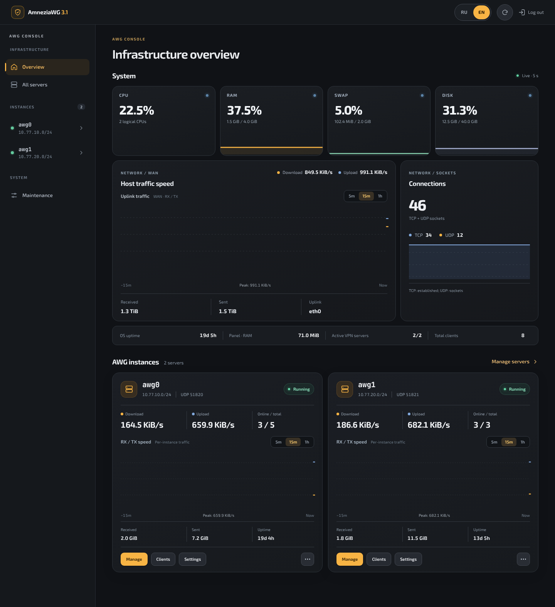

## What you get

- **AmneziaWG 3.1 only.** The wizard builds the official kernel module (pinned commit) and tools (pinned tag) and refuses to continue with any other version.
- **Random obfuscation per server.** `S1–S4`, `H1–H4`, `Jc`, junk packet sizes (`Jmin` 40–79, `Jmax` 50–160 above it), a random padding of data packets (`ContentPaddingAddition`) and `HeaderProtectionKey` are generated for every server, including the first one, and can be regenerated in the panel.
- **Several independent servers** (`awg0`, `awg1`, … up to 8), each with its own keys, subnet, UDP port and clients. Each new server can get a random `10.x.y.0/24` subnet; a client can move to another server with the same keys, owner, limits and subscription.
- **Clients:** `.conf` download, QR code, `vpn://` link for AmneziaVPN, comment, expiry date, traffic quota (lifetime or reset every month), speed limit, networks behind a client (site-to-site), creating up to 50 numbered clients at once with a ZIP of configurations, actions on the selected clients (enable, disable, extend, set a quota, delete), a CSV export of the list, key replacement with one button, groups and list filters by group and state.
- **Per-server traffic switches:** clients may reach each other or are isolated (also from clients of the other servers); access to the private networks behind the server can be closed; the server's own services (SSH, the panel) can be closed to clients; client IPv6 can be routed into the tunnel and dropped. The cloud metadata address range is always closed to clients. Networks behind a client keep working in every state.
- **Stale-configuration badge:** the client list shows who needs a new file after settings changed.
- **I1–I5 packets:** a Generate button for each field and ready-made templates for `I1` (random bytes, DNS query, STUN binding request, QUIC-shaped packet). Enabling them with empty fields creates `I1` automatically.
- **Extra [Interface] lines** for clients on a router, in a container or on a Linux gateway: `PostUp`, `PostDown`, `Table` and the like go into the `.conf`, its QR code and the bot, but not into the `vpn://` link. Ready-made templates and applying them to several clients at once.
- **Monitoring:** host CPU, RAM, swap, disk and uplink traffic, per-server traffic charts, 30 days of history collected by a systemd timer.
- **Backups:** full archives with checksums, download, schedule (daily or weekly), retention, restore with a safety snapshot; optional passphrase encryption (OpenPGP), after which the bot delivers every new backup to Telegram.
- **Two-factor sign-in:** TOTP codes from any authenticator app in addition to the password, and 10 one-time recovery codes for a lost phone.
- **Security by layout:** the panel runs as an unprivileged user on `127.0.0.1`; root actions go through one narrow `sudo` allowlist, served by a local root helper so pages stay fast with hundreds of clients; strict CSP, CSRF tokens, scrypt password hash, audit log.
- **Telegram bot (optional):** clients, configurations with QR codes, server start and stop, backups and notifications, through its own narrower `sudo` allowlist.
- **Optional Nginx** reverse proxy with a self-signed or your own certificate.
- **Router subscriptions:** a permanent HTTPS link from which a router or container fetches its current `.conf` by itself (with `ETag` and a 304 answer when nothing changed), plus a ready script for MikroTik, OpenWrt, Docker and Linux.
- **When the port gets blocked:** masking profiles (port plus a QUIC, STUN, DTLS or DNS shaped `I1`), a new port, obfuscation and server key in one press or on a schedule, and a 15-second incoming packet check in the panel and the bot.
- **Server networking:** TCP fitted to the tunnel MTU on the server (MSS clamping) and protective kernel settings (`rp_filter`, no ICMP redirects, SYN cookies).

## Requirements

| | |
|---|---|
| OS | Ubuntu 24.04 / 26.04 LTS, Rocky Linux 9 / 10 |
| CPU | x86_64 or aarch64 |
| Access | root, an interactive terminal, outbound access to GitHub and PyPI |
| Network | a public IPv4 address (or DNS name) and one free UDP port |

The installer needs kernel headers that match the running kernel. Secure Boot may stay enabled: the wizard asks you to enrol the DKMS key (MOK) from the server console after a reboot.

## Quick Start

Run as root (`sudo -i` first if you are not):

```bash
bash <(curl -Ls https://raw.githubusercontent.com/stepm65/amneziawg31-installer/main/install.sh)
```

To install a specific version, append its tag (e.g. `v0.9.6`):

```bash
bash <(curl -Ls https://raw.githubusercontent.com/stepm65/amneziawg31-installer/main/install.sh) v0.9.6
```

To install the rolling build (the current `main` branch, not a release), pass `dev-latest`:

```bash
bash <(curl -Ls https://raw.githubusercontent.com/stepm65/amneziawg31-installer/main/install.sh) dev-latest
```

Without a root shell the same installer runs as `curl -Ls https://raw.githubusercontent.com/stepm65/amneziawg31-installer/main/install.sh | sudo bash` (add `-s -- v0.9.6` for a version).

The installer builds the kernel module and tools, then starts a short wizard. Every question has a default, so Enter is enough:

1. VPN subnet (`/24`…`/29`, default `10.77.10.0/24`), UDP port, MTU.
2. Public IPv4 or DNS name of the server, DNS for clients.
3. Traffic mode: **full** (all client IPv4 through the VPN, NAT on the server) or **split** (VPN subnet only).
4. Local TCP port of the panel and the name of the first client.
5. Reverse proxy: none, Nginx with a self-signed certificate, or Nginx with your certificate.
6. Administrator password: type your own (twice, at least 12 characters) or press Enter and a random one is generated and shown once at the end.

A generated password is written to `/root/awg31-initial-password.txt` (readable by root only), not printed. If ufw or firewalld is active, the wizard offers to open the VPN port in it.

After installation, run `sudo awg31` to see the management commands: status, update, backups, password reset, panel port, Nginx setup, uninstall and more.

Every release is published with a `.sha256` sum next to the archive. Both `install.sh` and `awg31 update` verify the archive against that sum and abort on a mismatch, before anything is unpacked. The sum protects against a damaged or truncated download; it comes from the same release page as the archive. `dev-latest` is not a release and is not checksum-pinned.

Take a snapshot of the VPS before installing on a machine that already does something useful, and keep console access at hand. Then open the UDP port in your provider's firewall.

If you skipped Nginx, reach the panel through an SSH tunnel:

```bash
ssh -L 8080:127.0.0.1:8080 root@your-server
# then open http://localhost:8080
```

If the sign-in page keeps coming back, your browser refuses the secure session cookie over plain HTTP: use Chrome or Firefox for the tunnel, or set up Nginx (`sudo awg31 nginx`).

Prefer to read the code first? Clone the repository and run `sudo bash install.sh` inside it: the result is the same.

### Unattended installation

For automation, set `AWG31_UNATTENDED=1`: no questions are asked and defaults are used unless a variable overrides them.

```bash
curl -Ls https://raw.githubusercontent.com/stepm65/amneziawg31-installer/main/install.sh | \
  sudo env AWG31_UNATTENDED=1 AWG31_ENDPOINT=vpn.example.com AWG31_PORT=51820 bash
```

| Variable | Default |
|---|---|
| `AWG31_SUBNET` | `10.77.10.0/24` |
| `AWG31_RANDOM_SUBNET` | `0`; `1` gives a random `10.x.y.0/24` (when `AWG31_SUBNET` is not set) |
| `AWG31_PORT` | `51820` |
| `AWG31_MTU` | `1280` |
| `AWG31_ENDPOINT` | detected public IPv4 |
| `AWG31_DNS` | `1.1.1.1` |
| `AWG31_MODE` | `full` |
| `AWG31_UPLINK` | interface of the default route |
| `AWG31_PANEL_PORT` | `8080` |
| `AWG31_FIRST_CLIENT` | `test-client` (`skip` for none) |
| `AWG31_PASSWORD_FILE` | none: a password is generated into `/root/awg31-initial-password.txt` |
| `AWG31_OPEN_FIREWALL` | `yes`: open the UDP port in an active ufw/firewalld |
| `AWG31_NGINX_CHOICE` | `0` (no Nginx); `1`/`2` also need `AWG31_NGINX_HOST`, and `2` needs `AWG31_NGINX_CERT`, `AWG31_NGINX_KEY` |
| `AWG31_TELEGRAM_TOKEN`, `AWG31_TELEGRAM_ADMINS` | none: no bot (see [Telegram bot](#telegram-bot)) |

## The panel

| Clients | Export |
|---|---|
| 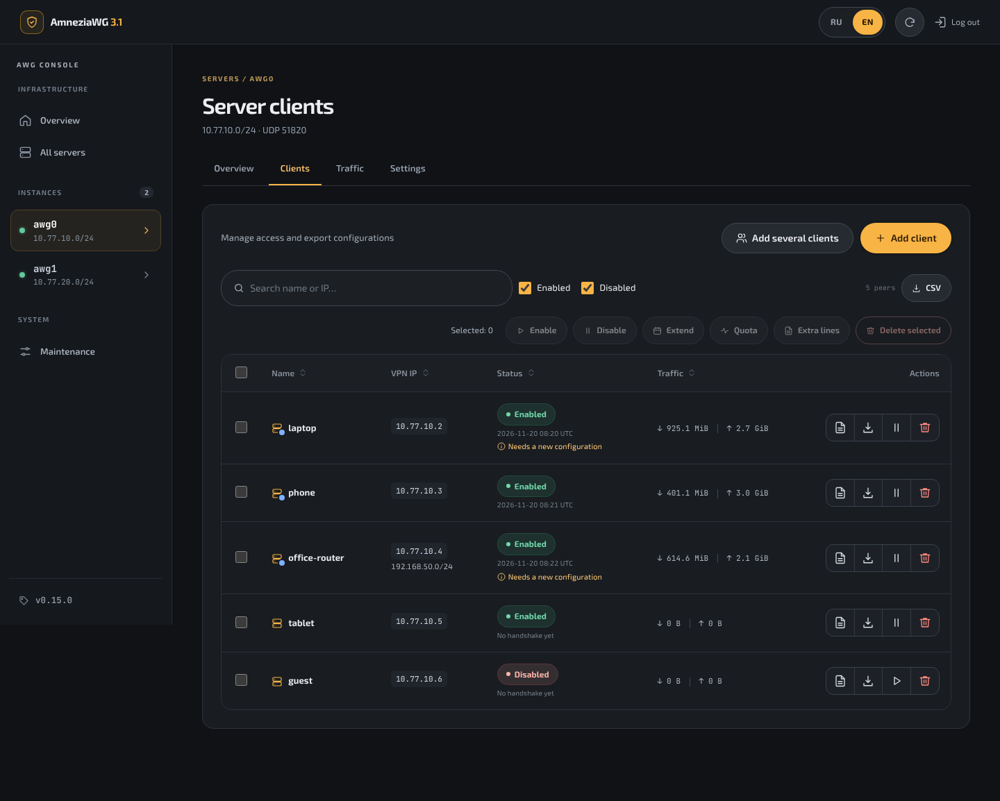 | 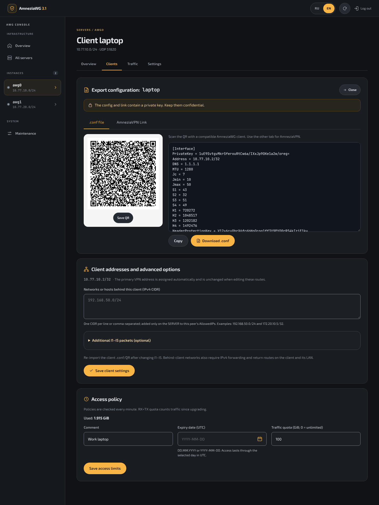 |

| Traffic | Server settings |
|---|---|
| 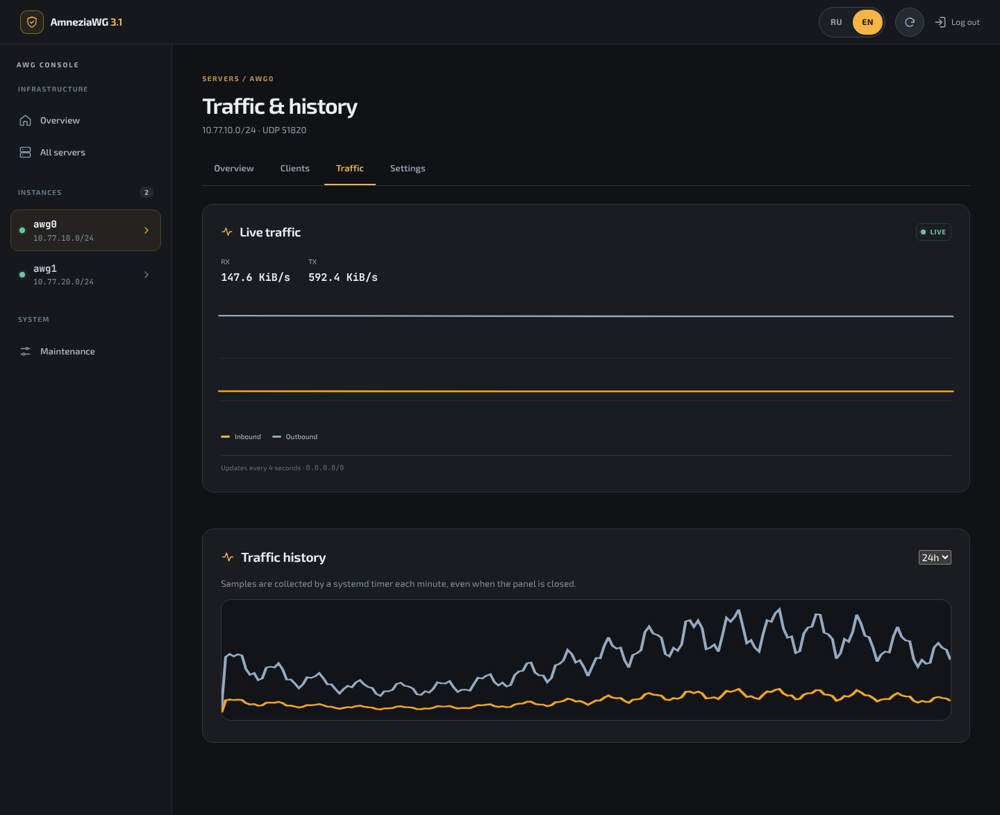 | 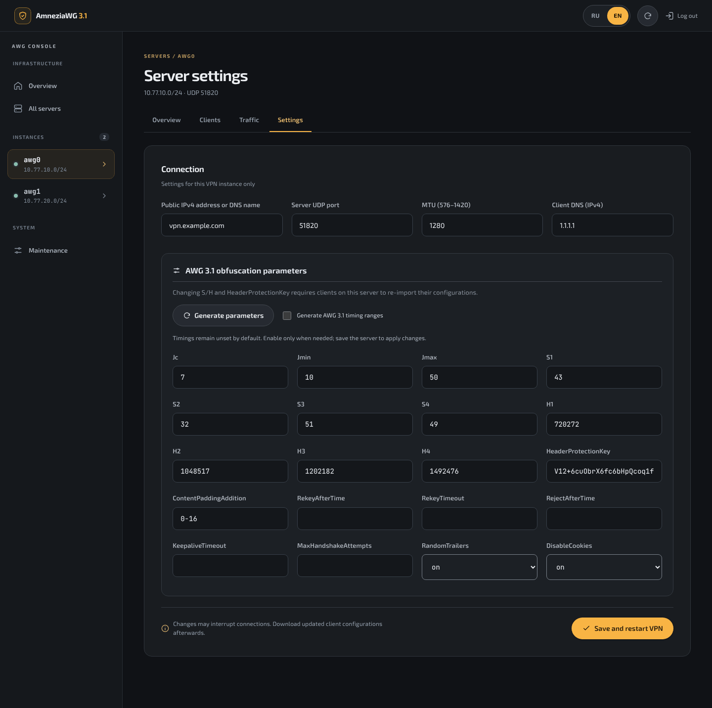 |

| I1–I5 editor | Backups |
|---|---|
| 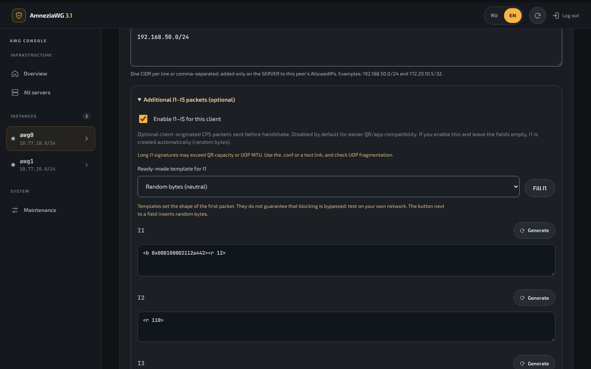 | 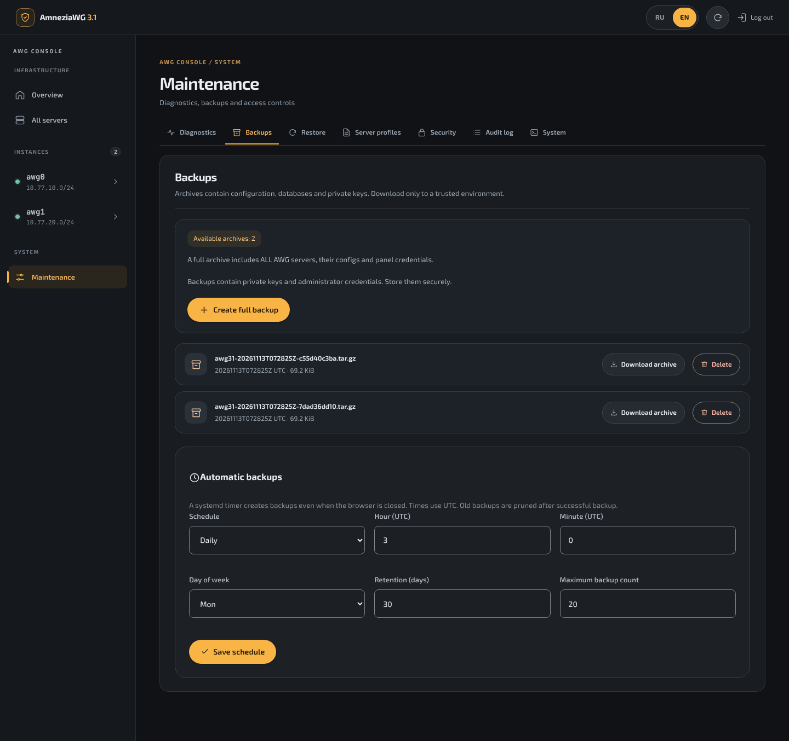 |

| Two-factor sign-in | Telegram bot |
|---|---|
| 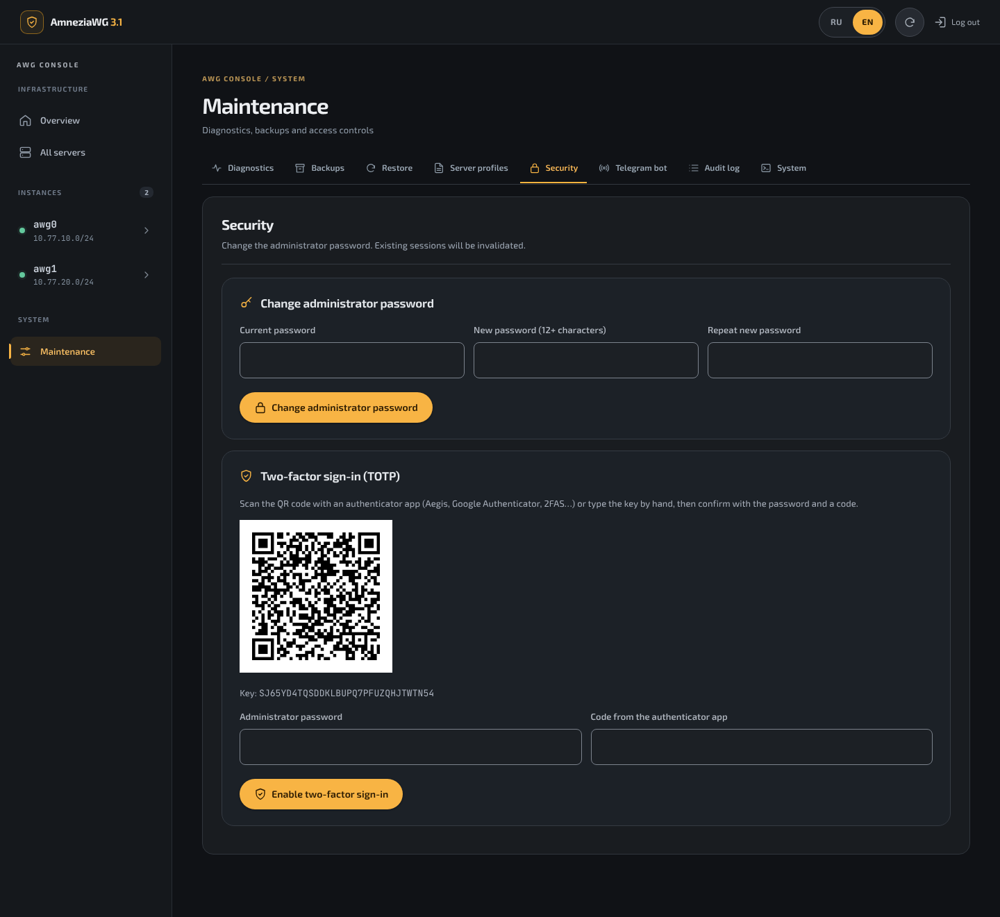 | 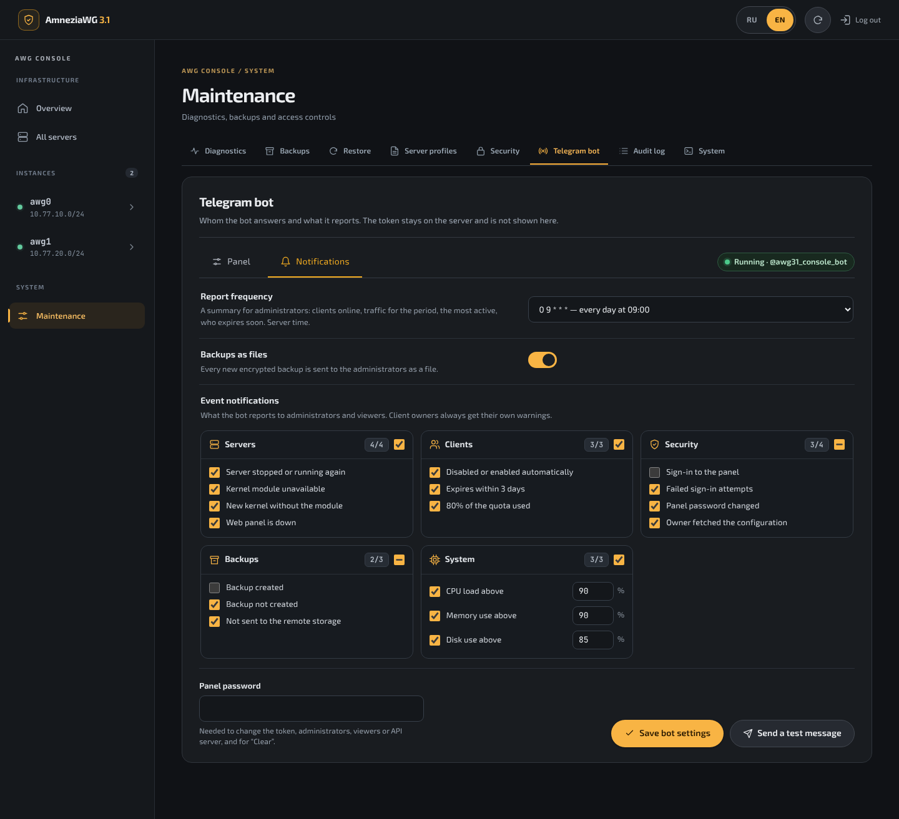 |

| Logs | Connection history |
|---|---|
| 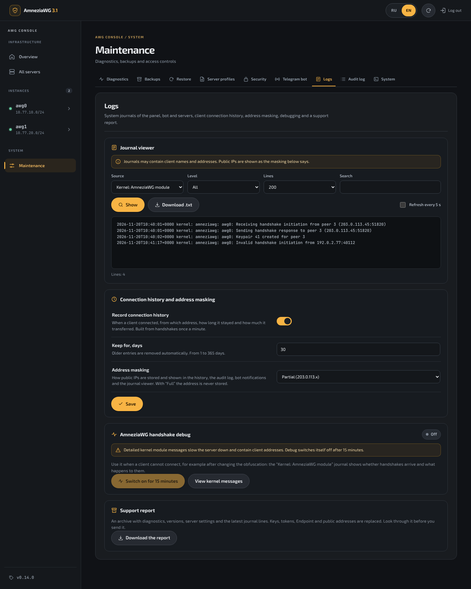 | 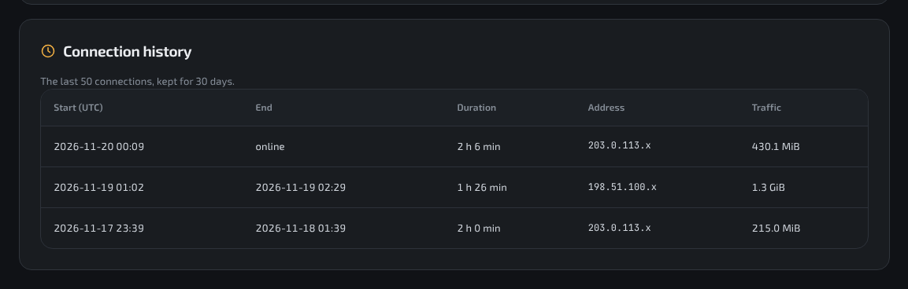 |

Screenshots show demo data.

### Logs

AmneziaWG itself writes nothing about connections, and the panel runs without a request log. **Maintenance → Logs** gathers what there is:

- **Journal viewer:** the panel, the bot, the helper, client polling, backups, the new-kernel check, each server's `awg-quick@` unit and the AmneziaWG kernel messages — by level, number of lines and text, refreshed every 5 seconds if you like, or downloaded as `.txt`. Only this fixed list of journals can be read.
- **Connection history** (off by default): built once a minute from handshakes — when a client connected, from which address, how long it stayed and how much it transferred. Shown on the client's page; kept 1–365 days (30 by default).
- **Address masking** of public IPs, as in 3x-ui: none (`203.0.113.45:51820`), partial (`203.0.113.x`, the default) or full (`IP-3f2a1c`, a label that cannot be turned back into the address). It applies to the connection history, the audit log (sign-in attempts), bot notifications and the journal viewer, and it applies when the data is written: with full masking the address is never stored. Tunnel and private addresses are left as they are.
- **Handshake debug** turns on detailed AmneziaWG kernel messages for 15 minutes and switches them off by itself — for a client that cannot connect, for example after the obfuscation was changed.
- **Support report:** one archive with diagnostics, versions, server settings and the latest journal lines. Keys, tokens, `Endpoint` lines and public addresses are replaced; look through it before you send it.

The **audit log** has pages, filters by event, dates and text, a CSV export, and reads the rotated files too.

### I1–I5 templates

| Template | What is sent before the handshake |
|---|---|
| Random bytes | one packet of 40–119 random bytes |
| DNS query | a well-formed A-record query for a popular domain, random ID |
| STUN binding request | a 20-byte RFC 5389 request with a random transaction ID |
| DTLS 1.2 ClientHello | the first packet of a WebRTC call (with `use_srtp`), a fresh random field each time |
| QUIC Initial with ClientHello | a complete 1200-byte QUIC v1 Initial with a TLS 1.3 ClientHello and the server name (SNI) you choose; it decrypts as genuine QUIC and is accepted by a real QUIC server implementation in the tests |
| QUIC Initial, shape only | the same header and size, random payload, random connection ID on every send; short notation that fits into a QR code, but it does not decrypt as QUIC |

Short notation does not mean a small packet: `<r 1000>` is 1000 random bytes on the wire. The ClientHello template is written as a 2400-character hex string, is the same on every connection and does not fit into a QR code, so give the client the `.conf` file. You can also paste your own captured packet as `<b 0x…>`.

Templates only set the shape of the first packets. Whether they help against a particular filter depends on that network, so test them where you use the VPN. After changing I1–I5, import the client configuration again.

### Groups, filters, actions on the selected clients and CSV

A client can have a **group** (“office”, “family”, …): set it in the creation form, on the client page, or for the selected clients with the **Group** button. The group is shown next to the name. Above the list there are the chips All, Online, Offline and Off, a group filter (including “No group”) and a flag filter: expires within 3 days, needs a new configuration, routers with a subscription, with a Telegram owner. The search also looks at the group and the comment. “Select all” selects only the visible rows, so a group can be filtered and then extended, switched off or reconfigured at once.

Select clients in the list and the buttons **Enable**, **Disable**, **Extend**, **Quota**, **Group**, **Extra lines** and **Delete selected** appear above the table. Extending counts from the current expiry, or from today for expired clients; clients without expiry do not change. Clients disabled by expiry or quota come back on their own after an extension or a new quota. A report stays above the list: how many clients changed, who was skipped and why (already in that state, expired, quota used up, no expiry).

The **CSV** button exports the server’s client list: name, address, state, comment, expiry, quota and usage, last handshake, speed limit, owner. The file has no keys; values a spreadsheet would read as a formula are written as text. Every export goes to the audit log.

### Extra [Interface] lines

A client that brings the tunnel up with `awg-quick` itself (a router, a container on MikroTik or OpenWrt, Docker, a Linux gateway) often needs its own commands in the configuration. Set them once in the “Extra [Interface] lines” block on the client page and they are in every downloaded `.conf`, its QR code and the file from the bot. They are left out of the `vpn://` link: AmneziaVPN apps do not run such commands. The commands run on the client, never on the server.

Allowed are `PreUp`, `PostUp`, `PreDown`, `PostDown`, `Table` and comment lines starting with `#`. Sections and the parameters the panel manages (`Address`, `DNS`, `MTU`, `AllowedIPs`, obfuscation, `I1`–`I5`) are refused, and so is `#` inside a command: `awg-quick` would take the rest of the line for a comment.

The “Insert a template ▾” menu:

| Template | What it adds |
|---|---|
| Gateway for a local network | NAT into the tunnel, MSS clamping, `Table = 200` and a rule that sends LAN traffic into the tunnel. The LAN interface is found when the tunnel comes up (the default-route interface, otherwise the only one besides `lo` and the tunnel), so one template fits several containers with different `veth` names. |
| MSS clamping only | fits TCP packets to the tunnel MTU |
| NAT only | masquerades the traffic that goes into the tunnel |

To give several clients the same lines, select them in the list and press “Extra lines”: the lines replace theirs or are added to them, and the panel keeps each identical command once, even when templates overlap (the gateway already includes NAT and MSS clamping). In the list such clients have a blue dot on their icon and need a new `.conf` after a change.

### Router subscriptions

A router or a container that brings the tunnel up with `awg-quick` can fetch its own configuration. On the client page, under “Subscription for a router”, press **Switch the subscription on**: the panel shows a link like `https://your-address/sub/awg0/…` once, with the `awg-sub.sh` script (copy or download it). The panel keeps only a fingerprint of the link; a lost link cannot be shown again, so issue a new one and the old one stops at once.

The link returns the client's current `.conf` with its extra `[Interface]` lines. When nothing changed since the last request, the server answers `304 Not Modified`. Run the script every 5 minutes from cron (`*/5 * * * * sh /etc/amnezia/awg-sub.sh`) or in the background (`sh awg-sub.sh --loop`): it checks a new file, keeps the previous one as `.bak`, restarts the tunnel and goes back to the old file if the new one does not come up. When there has been no handshake for over 3 minutes, the script takes the tunnel down for a moment and asks the link directly, which helps when the tunnel carries the default route. For a self-signed certificate the script carries the fingerprint of its key (`curl --pinnedpubkey`).

Subscriptions work only through the panel's HTTPS address (`sudo awg31 nginx`): the link carries the client's private key. The `/sub/` path is open to every address even when the panel admits only chosen ones, but it is rate limited (by Nginx and by the panel; after 10 wrong links an address waits 15 minutes). A switched-off client gets 403. The time and address of the last request are on the client page.

### When the port gets blocked

Under **Server settings → Masking and parameter change**:

- **Masking profile** moves the server to the profile's port and writes the same kind of `I1` for every client: QUIC (443), STUN (3478), DTLS 1.2 as in WebRTC calls (8801), a DNS query (53) or a Steam game server query (27015). The “Custom” profile takes a port and an `I1` packet by hand. The content is random each time; only the packet shape repeats. A profile does not guarantee getting past blocking: test it on the network where you use the VPN. New clients get the profile's `I1` by themselves.
- **Change now**: a new random port 20000–59999, new `S1–S4`, `H1–H4`, header key and `Jc`, and, if you like, a new server key and new keys for the clients with a subscription (routers fetch them by themselves). Clients, their addresses, keys (other than those chosen) and limits stay; so do your `Jmin/Jmax`, timings, `RandomTrailers` and `DisableCookies`. ufw and firewalld get the new port opened automatically; a cloud firewall is up to you.
- **On a schedule**: the same every 1, 3, 7, 14 or 30 days. Useful when the clients are routers with a subscription: they pick up the new parameters by themselves. Phones and computers without one drop until they import again.

A copy of the server settings is saved before every change. Changes go to the audit log, the bot tells the administrators (event “Server parameter change”), and the bot's server menu has a “🔀 Change port” button.

After a parameter change, a masking profile, a client move, or server settings that change client configurations (address, port, DNS, MTU, obfuscation), the bot sends the new configuration (file and QR code) to every client owner allowed to get it. Owners without that permission are told to ask the administrator for a new one. Routers with a subscription and switched-off clients get no message.

### Moving a client to another server

On the client page, under “Move to another server”, choose the server and press **Move**. The client moves with the same keys, comment, owner, expiry, limits, traffic used, `I1–I5` packets, extra lines, subscription and pending invitation, and gets a free address in the new server's subnet. If the new server already has a client with that name or key, nothing moves. The client needs a new configuration: its subscription link keeps working and serves it from the new server, and the bot sends it to an owner allowed to get it.

### Blocking signal

In the same settings section there is a **Blocking signal**. When two or more clients were connected and all of them vanish at once, with no handshake for longer than the chosen time (15, 30, 60 or 120 minutes, 30 by default), the server page shows a warning and the bot tells the administrators (event “All clients gone at once”). When clients connect again, the bot says so too. One client leaving or a stopped server is not a signal. If you like, the server changes its port and obfuscation by itself at that moment: routers with a subscription follow, and the bot sends new files to owners allowed to get them.

### Incoming packet check

The **Check incoming packets (15 s)** button on the server page (and “📡 Packets 15 s” in the bot) listens on the server's UDP port for 15 seconds. Switch the VPN on at the client right after pressing. Not a single packet: traffic does not reach the server (cloud firewall or the provider's blocking). Packets arrive but the server does not answer: the client has other keys or obfuscation. Both: the network is fine, look at the client. Packet sizes and sender addresses are shown (masked as in the logs).

## Server console

```text
sudo awg31 status           panel and VPN instances
sudo awg31 update [VER]     update to the latest release, vX.Y.Z or dev-latest
sudo awg31 rollback         return to the version before the last update (list: snapshots, --yes: no question)
sudo awg31 version          installed version
sudo awg31 servers          configured interfaces
sudo awg31 doctor           kernel, DKMS and interface checks
sudo awg31 backup           create a full backup
sudo awg31 backups          list backups
sudo awg31 restore-check N  verify a backup
sudo awg31 restore N        restore a backup (VPN restarts)
sudo awg31 reset-password   set a new panel password
sudo awg31 totp-off         turn off two-factor sign-in (lost authenticator)
sudo awg31 backup-encryption on|off|status|change   encrypt backups with a passphrase
sudo awg31 backup-remote s3|sftp|test|status|off    upload every new backup to S3 or SFTP
sudo awg31 port N           change the local TCP port of the panel
sudo awg31 uninstall        remove the console; --purge also deletes VPN data
sudo awg31 nginx            configure the Nginx HTTPS proxy
sudo awg31 telegram         connect the Telegram bot (status | test | off)
sudo awg31 restart-panel    restart the web panel only
sudo awg31 logs             panel logs
```

## Telegram bot

Optional. The bot manages clients and servers from Telegram and tells you when something happens. It polls Telegram itself, so no inbound port is opened.

```bash
sudo awg31 telegram          # connect: asks for the token from @BotFather and finds your Telegram ID
sudo awg31 telegram status   # is it running, who may use it
sudo awg31 telegram test     # send a test message
sudo awg31 telegram off      # stop the bot and delete the token from the server
```

In the panel: **Maintenance → Telegram bot**. Paste the token and, as in 3x-ui, the numeric Telegram IDs of the administrators separated by commas (@userinfobot shows yours): the bot connects at once. Leave the ID field empty and send `/start` to the new bot in a private chat instead: the panel finds the sender and asks you to confirm. Viewers, language, your own Bot API server and notifications can be changed once it is connected.

| The bot can | Only in the panel or the console |
|---|---|
| create a client and send its `.conf` and QR code | delete a server, create a server |
| enable, disable, delete a client; set expiry and quota | change server settings, obfuscation, client networks |
| show servers, clients, traffic, kernel module and panel state | restore, download or delete a backup |
| start, stop, restart a server | change the panel password |
| create a backup | |

Notifications (each group can be turned off during setup): a server went down or came back, the kernel module is not loaded, the panel service stopped; a client was disabled by expiry or quota, a client expires within three days; sign-in to the panel, failed sign-in attempts, password change; a backup was created or the scheduled backup failed.

Only the numeric Telegram IDs you list are administrators, and only in a private chat with the bot; apart from client owners (below) everybody else gets no answer. Deleting a client and stopping a server ask for confirmation. Everything done through the bot is written to the audit log with the Telegram ID.

### Roles, digest and settings in the panel

**Maintenance → Telegram bot** in the panel has two tabs.

- **Panel:** switch the bot on and off (the token and settings are kept), replace the token (the field never shows the current one; **Clear** disconnects the bot and deletes the token), administrators and **viewers**, the bot language, your own [Bot API server](https://core.telegram.org/bots/api#using-a-local-bot-api-server) instead of api.telegram.org, and **Send a test message**. Viewers see the same screens and get the notifications, but have no action buttons and cannot change anything. Anyone can send `/id` to the bot in a private chat to learn their numeric ID.
- **Notifications:** how often the **report** comes (every hour, every 6 or 12 hours, daily, Mondays, or any crontab line such as `30 8 * * 1-5`; server time): servers, clients online, traffic since the previous report, the most active clients, who expires within a week and who has not connected for a month. Then **backups as files** and a card per group of events — servers, clients, security, backups, system — each event with its own switch. The system card warns when CPU load stays above its threshold for three minutes, or memory or disk use is above theirs, and once more when it is back below.

A new token, other administrators or viewers, another API server and **Clear** ask for the panel password again.

When backup encryption is on (`sudo awg31 backup-encryption on`) and **backups as files** is on, every new backup is sent to the administrators as a `.gpg` file. Unencrypted archives are never sent.

### Client owners

The easiest way is an **invitation**. On the client page, in the block “Access: invitation and key” (or with the **Invite** button of the client in the bot), create a one-time link like `https://t.me/<bot>?start=<code>` and forward it to the person. They open it, press **Start** and become the owner of the client at once; there is no need to learn their ID. The link is valid for 1, 7 or 30 days and only once, a new link for the same client cancels the previous one, and a valid one can be revoked. The panel keeps only a fingerprint of the code, so the link is shown only when it is created. You can allow the owner to get the configuration in the bot right there. The administrators are told who used the invitation (event “Invitation used”), and the audit log keeps a record. Guessing is limited to five attempts in ten minutes per person.

A client can also carry, set by hand, the numeric Telegram ID of the person who uses it: the field **Owner’s Telegram ID** in the new-client form and on the client page, or the **Telegram ID** button in the bot. That person writes to the same bot and sees a single read-only screen with their own clients: enabled or disabled (and why), traffic used and the quota, last handshake, expiry date. They get a message three days before the expiry date. One ID may be set on several clients, also on different servers.

An owner cannot change anything or see other clients, servers and addresses. By default they cannot download the configuration either. The switch **The owner may get the configuration and QR code from the Telegram bot** (next to the ID field; in the bot — the button under the client) allows it for that one client: the owner then gets **Config** and **QR** buttons while the client is enabled. Each download is written to the audit log and reported to the administrators (group `security`). The switch turns off by itself when the owner's ID is changed or removed.

An owner of a client with an expiry date has an **Extend** button: the administrators get the request with ready answers (+7, +30, +90 days, refuse), and the owner is told the result. One request per client a day. The owner is also told when 80 % of the quota is used, when the client is disabled by expiry or quota, and when a monthly quota starts again. The person finds their numeric ID with any “user info” bot in Telegram, and has to press **Start** in your bot once: Telegram does not let a bot write first.

If a client’s configuration got into the wrong hands, press **Replace the key** on the client page (in the bot — **New key**): the client gets a new key pair and PSK, while address, limits, expiry, owner and history stay. The old configuration stops working at once. The bot sends the administrator the new file and QR code and tells the owner where to get the new configuration.

Unattended: `AWG31_TELEGRAM_TOKEN` and `AWG31_TELEGRAM_ADMINS` (IDs separated by commas), optionally `AWG31_TELEGRAM_LANG` (`ru`/`en`) and `AWG31_TELEGRAM_NOTIFY` (`all`, `none` or a list of `server,clients,security,backups`). They work both with the installer and with `sudo -E awg31 telegram`.

## Update

```bash
sudo awg31 update            # latest release
sudo awg31 update v0.9.6     # a specific release
sudo awg31 update dev-latest # rolling build from main
```

Running the Quick Start command again on a server that already has the console does the same thing. `awg31 update` uses the installer that came with the installed release, and refuses to install an older version unless `--allow-downgrade` is given. The update replaces the panel, the controller, fonts and the `sudo` allowlist, and refreshes the Python packages within the supported version ranges. Interfaces, keys, clients and firewall rules are left as they are.

Before every update a **snapshot** of the program is saved in `/var/backups/awg31-upgrade.*`: the panel (without its Python packages), the controller, the helper, the menu, the scripts, the `sudo` rules and the systemd units; next to it, as material for a manual recovery, the databases and server configurations. If an update fails, the program returns from the snapshot at once. `sudo awg31 rollback` returns to the version before the last update later: the snapshot is restored, the panel, the helper and the bot restart, the VPN keeps running. Clients, servers and settings made after the update stay: only the program goes back, not the data. The state before a rollback is saved as well, so a second `sudo awg31 rollback` goes forward again. `sudo awg31 rollback list` shows the snapshots; the five newest are kept. A rollback does not change the panel’s port.

### Updating from the panel

**Maintenance → Update** shows the installed and the latest version on GitHub, the notes of a new release and the button **Update to vX.Y.Z** (with the administrator password). The update runs in its own systemd unit, so it goes on while the panel, the helper and the bot restart; the page follows the installer’s log and reloads by itself once the new version is up. A **rollback** to any saved snapshot is there too. Only a newer release can be installed from the panel; the archive is checked against its SHA256 as in the console. The bot reports the outcome to the administrators (event “Panel update or rollback”). Updating from the panel is available from 0.16 on: the first update to it is made in the console. On systems where `/run` is mounted `noexec`, the 0.16 panel cannot start an update (it ends at once without a log): update to 0.17 once in the console with `sudo awg31 update`; from then on the panel update works.

The installed version is shown at the foot of the panel's sidebar and links to its release notes. When a newer release is published, a **vX.Y.Z is available** hint appears above it, leading to Maintenance → Update. The panel asks GitHub for the latest release in the background at most twice a day; `Environment=AWG31_UPDATE_CHECK=0` in `awg31-panel.service` switches that off.

If your installed `awg31` has no `update` command yet, run `bash <(curl -Ls https://raw.githubusercontent.com/stepm65/amneziawg31-installer/main/install.sh) --upgrade` once.

If a server shows a warning that `H1–H4` are `1, 2, 3, 4`, press **Generate parameters** in its settings, save, and hand out the client configurations again.

### Interrupted installation

If the installer stopped after the VPN was created but before the panel started, it will not overwrite the existing server. If nothing was created yet (the failure came before the VPN step), simply run the installer again. If the VPN exists and the stop happened after the administrator password step, finish the setup from a clone of the repository. To throw the half-made setup away and start over, run the installer with `--uninstall --purge`.

```bash
git clone https://github.com/stepm65/amneziawg31-installer.git
sudo bash amneziawg31-installer/scripts/resume-panel.sh
```

## Where things live

| Path | Contents |
|---|---|
| `/etc/amnezia/amneziawg/awgN.conf` | server configurations (private keys) |
| `/var/lib/awg31-panel/` | client databases, host metrics |
| `/etc/awg31-panel/auth.json` | password hash and session key |
| `/var/backups/awg31-panel/` | backups and pre-change snapshots |
| `/var/log/awg31-panel/audit.jsonl` | audit log |
| `/etc/awg31-panel/logging.json`, `ip-mask.key` | history and masking settings; the masking key (root only) |
| `/etc/awg31-bot/telegram.json` | Telegram bot token and administrator IDs |
| `/run/awg31/control.sock` | socket of the control helper (`awg31-helper.service`) |
| `/opt/awg31-panel/` | panel code, Python environment, fonts |
| `/etc/sysctl.d/96-awg31-network.conf` | protective kernel network settings (removed with the console) |

## Security notes

- A client `.conf`, `vpn://` link or QR code contains a private key. Whoever has it can connect.
- Backups contain every private key and the panel credentials and are **not encrypted by default**. Turn encryption on with `sudo awg31 backup-encryption on` and keep the passphrase away from the server: without it an encrypted backup cannot be restored elsewhere (`gpg -d file.tar.gz.gpg` opens it on any machine). The passphrase itself is stored on the server, readable by root only, so encryption protects archives that leave the server, not a compromised server.
- `sudo awg31 backup-encryption change` sets a new passphrase and re-encrypts the archives on the server that the current one opens. Copies already sent to Telegram or a remote storage keep the old passphrase.
- `sudo awg31 backup-remote s3` (AWS S3, MinIO, Backblaze B2, Yandex Object Storage and other S3-compatible services) or `sudo awg31 backup-remote sftp` uploads every new backup, scheduled or manual, right after it is created. Only encrypted archives are uploaded, so encryption has to be on. The access keys stay on the server, readable by root only; for SFTP the server gets its own SSH key and remembers the host key at the first connection. A failed upload does not fail the backup: it is written to the audit log and reported by the bot. Old files in the storage are not deleted — use the lifecycle rules of the storage.
- After a kernel update the console checks, several times a day, that the AmneziaWG module is built for the new kernel, and tries to build it. If that fails, the panel (Maintenance → System) and the bot warn before the reboot that would leave the VPN down.
- Two-factor sign-in is set up in **Maintenance → Security**. When it is switched on, the panel shows 10 recovery codes once: each replaces an app code for one sign-in, together with the password. Only their hashes are stored; the same place shows how many are left and creates new ones (the previous ones stop working). The bot tells the administrators about a sign-in with a recovery code. Without both the phone and the codes the second factor is reset from the console with `sudo awg31 totp-off`.
- Speed is limited apart for download (to the client) and upload (from the client); 0 means no limit in that direction. It works with `tc` on the VPN interface and covers the networks behind the client. Download goes through the client’s own queue and stays smooth; upload above the limit is dropped, so it may come out slightly lower. The bot sets one number for both directions. After the update to 0.19.6 the former single limit keeps applying both ways. A monthly quota resets on the first day of the month, UTC.
- Do not expose the panel without HTTPS. The generated Nginx site sends HSTS, limits sign-in attempts per address and can restrict access to the addresses you list (`sudo awg31 nginx`).
- The Telegram bot sends client configurations (private keys) into your chat with it; they stay in the Telegram cloud. Whoever controls an administrator's Telegram account can create and delete clients and stop servers, so protect that account with two-step verification. The bot token is removed by `sudo awg31 telegram off` and by uninstalling.
- Signing out ends every session of the panel, including a copied cookie.
- Restoring a backup keeps the current administrator password; the one in the archive is used only when none exists.
- In full mode only IPv4 goes through the tunnel. Turn on “Client IPv6: block” in the server settings (clients then need a new configuration), or disable IPv6 on the clients; otherwise IPv6 traffic bypasses the VPN.
- By default VPN clients can reach services of the server itself on its VPN address (for example SSH). The server setting “Client access to services of the server itself → Denied” closes them: only replies, ping and DNS (when the server is the clients' DNS) pass. Other INPUT rules of the host are not managed by the console.
- After a kernel update, run `sudo awg31 doctor`: the module is rebuilt by DKMS only if headers for the new kernel are installed.

More in [SECURITY.md](SECURITY.md).

## Compatibility

| Platform | Status |
|---|---|
| Ubuntu 26.04 | confirmed on a live server; full installation test on every change (kernel 7.0, sudo-rs, Python 3.14, Nginx) |
| Ubuntu 24.04 | full installation test on every change, Nginx included |
| Rocky Linux 9 | installation test on every change with SELinux enforcing, without the Nginx part; with firewalld check NAT in full mode yourself |
| Rocky Linux 10 | supported by the installer, not tested |

The installation tests run in GitHub Actions on real (virtual) machines: kernel module build, the VPN, firewall rules, the panel, the control helper, the Telegram bot against a stand-in Telegram, backups with restore, two-factor sign-in, a second server, update in place and uninstall.

Every commit is also installed for real on a GitHub Actions Ubuntu 24.04 machine: unattended installation, kernel module, firewall rules, the panel, update in place, port change and purge.

Not yet confirmed on a live server: restoring a backup, running several servers at once, the IPv6 block with every client app, and `vpn://` links and QR codes with every AmneziaVPN release (the plain `.conf` is the reference format).

## Development

```bash
python -m pip install -r src/requirements.txt pytest httpx cryptography
python -m pytest -q
```

Releases are built by GitHub Actions: set the number in `VERSION`, then push a tag `vX.Y.Z` or publish a release with that tag on github.com, and the workflow runs the tests, builds `awg31-console-vX.Y.Z.tar.gz` with its `.sha256` and publishes the release.

Third-party components and font licences are listed in [THIRD_PARTY.md](THIRD_PARTY.md).
