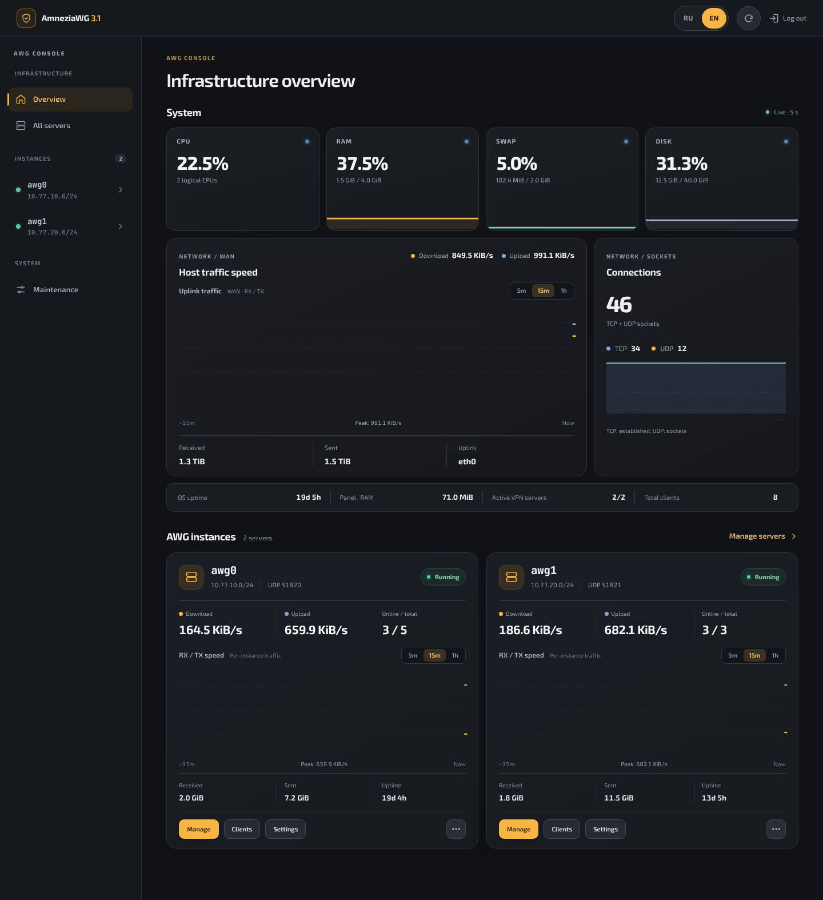
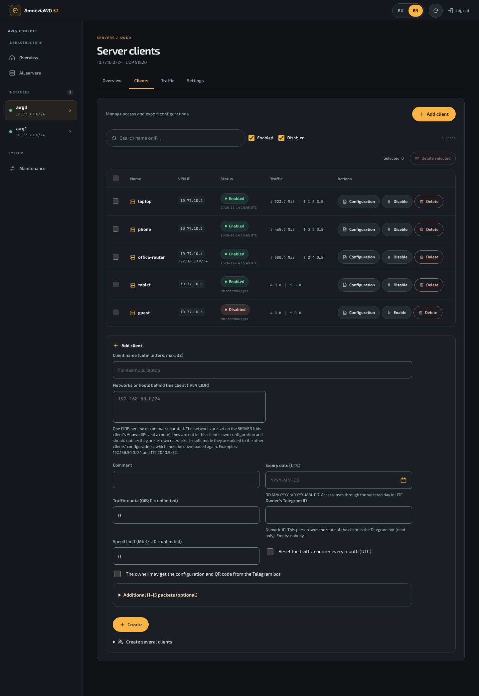
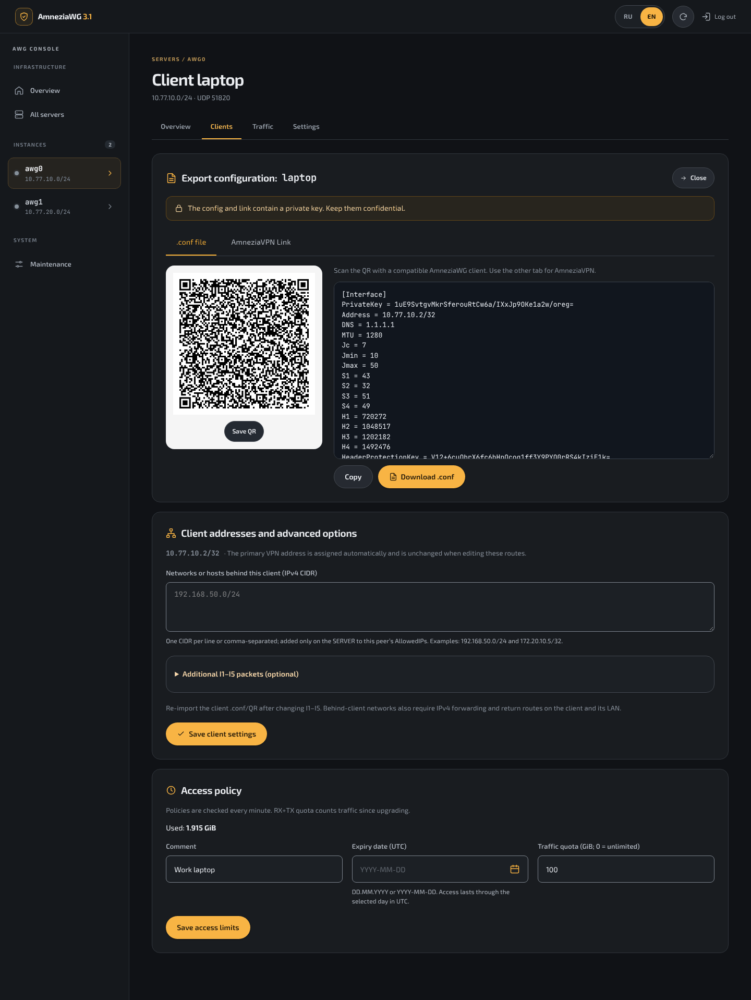
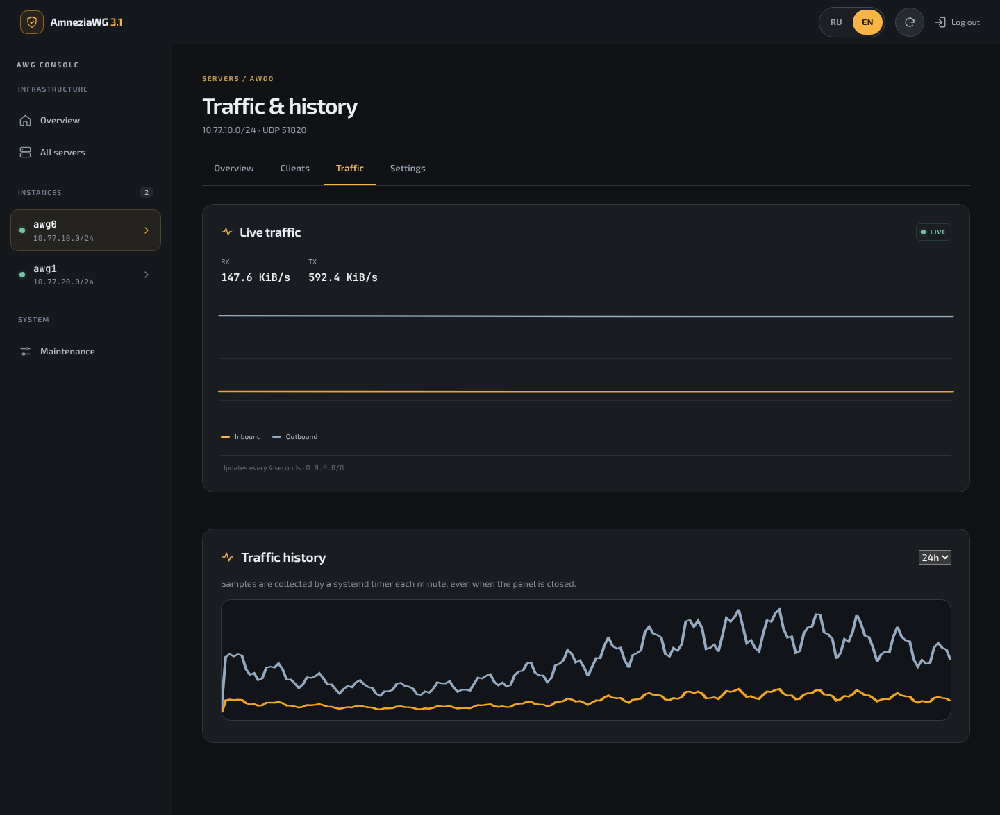
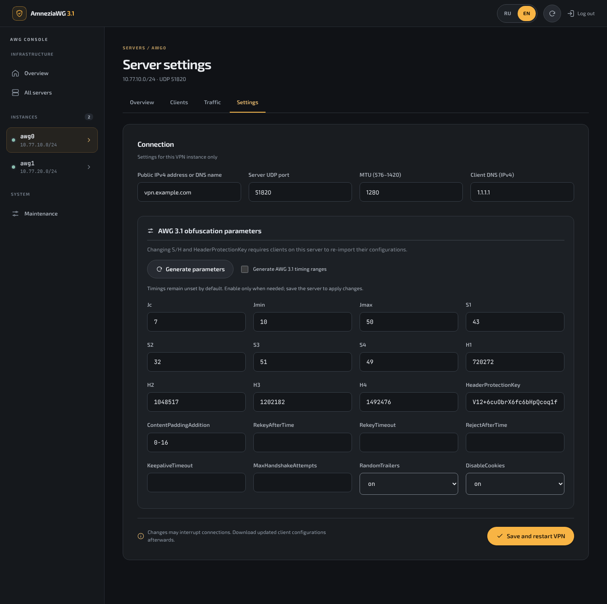
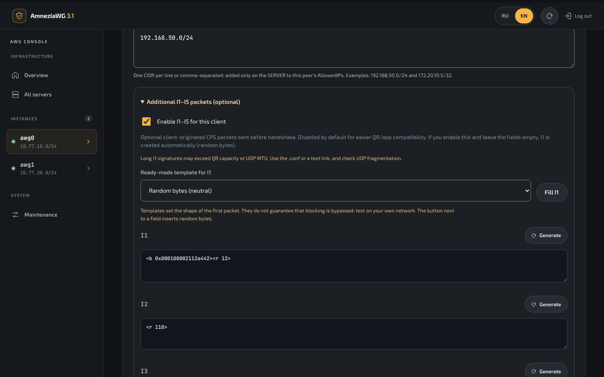
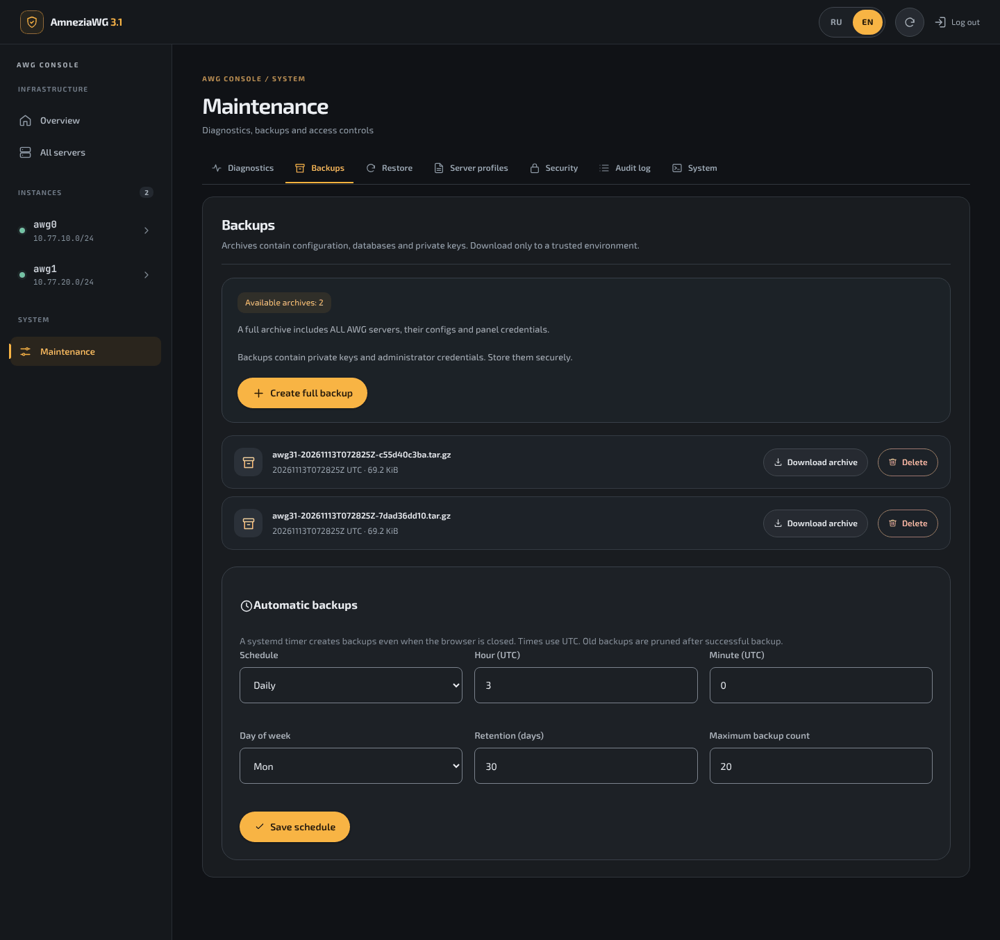

# AmneziaWG 3.1 Console

**English** · [Русский](README.ru.md)

An installer and a web console for running **AmneziaWG 3.1** on your own server: a kernel module built with DKMS, an interactive setup wizard and a bilingual (EN/RU) panel for servers, clients, traffic and backups. No Docker, no control plane in the cloud, nothing loaded from a CDN.

Version **0.9.9** · MIT licence · not affiliated with the AmneziaVPN developers.



## What you get

- **AmneziaWG 3.1 only.** The wizard builds the official kernel module (pinned commit) and tools (pinned tag) and refuses to continue with any other version.
- **Random obfuscation per server.** `S1–S4`, `H1–H4`, `Jc`, `HeaderProtectionKey` are generated for every server, including the first one, and can be regenerated in the panel.
- **Several independent servers** (`awg0`, `awg1`, … up to 8), each with its own keys, subnet, UDP port and clients.
- **Clients:** `.conf` download, QR code, `vpn://` link for AmneziaVPN, comment, expiry date, traffic quota, networks behind a client (site-to-site), bulk delete.
- **Per-server traffic switches:** clients may reach each other or are isolated (also from clients of the other servers); access to the private networks behind the server can be closed; client IPv6 can be routed into the tunnel and dropped. The cloud metadata address range is always closed to clients. Networks behind a client keep working in every state.
- **Stale-configuration badge:** the client list shows who needs a new file after settings changed.
- **I1–I5 packets:** a Generate button for each field and ready-made templates for `I1` (random bytes, DNS query, STUN binding request, QUIC-shaped packet). Enabling them with empty fields creates `I1` automatically.
- **Monitoring:** host CPU, RAM, swap, disk and uplink traffic, per-server traffic charts, 30 days of history collected by a systemd timer.
- **Backups:** full archives with checksums, download, schedule (daily or weekly), retention, restore with a safety snapshot.
- **Security by layout:** the panel runs as an unprivileged user on `127.0.0.1`; root actions go through one narrow `sudo` allowlist; strict CSP, CSRF tokens, scrypt password hash, audit log.
- **Telegram bot (optional):** clients, configurations with QR codes, server start and stop, backups and notifications, through its own narrower `sudo` allowlist.
- **Optional Nginx** reverse proxy with a self-signed or your own certificate.

## Requirements

| | |
|---|---|
| OS | Ubuntu 24.04 / 26.04 LTS, Rocky Linux 9 / 10 |
| CPU | x86_64 or aarch64 |
| Access | root, an interactive terminal, outbound access to GitHub and PyPI |
| Network | a public IPv4 address (or DNS name) and one free UDP port |

The installer needs kernel headers that match the running kernel. Secure Boot may stay enabled: the wizard asks you to enrol the DKMS key (MOK) from the server console after a reboot.

## Quick Start

Run as root (`sudo -i` first if you are not):

```bash
bash <(curl -Ls https://raw.githubusercontent.com/stepm65/amneziawg31-installer/main/install.sh)
```

To install a specific version, append its tag (e.g. `v0.9.6`):

```bash
bash <(curl -Ls https://raw.githubusercontent.com/stepm65/amneziawg31-installer/main/install.sh) v0.9.6
```

To install the rolling build (the current `main` branch, not a release), pass `dev-latest`:

```bash
bash <(curl -Ls https://raw.githubusercontent.com/stepm65/amneziawg31-installer/main/install.sh) dev-latest
```

Without a root shell the same installer runs as `curl -Ls https://raw.githubusercontent.com/stepm65/amneziawg31-installer/main/install.sh | sudo bash` (add `-s -- v0.9.6` for a version).

The installer builds the kernel module and tools, then starts a short wizard. Every question has a default, so Enter is enough:

1. VPN subnet (`/24`…`/29`, default `10.77.10.0/24`), UDP port, MTU.
2. Public IPv4 or DNS name of the server, DNS for clients.
3. Traffic mode: **full** (all client IPv4 through the VPN, NAT on the server) or **split** (VPN subnet only).
4. Local TCP port of the panel and the name of the first client.
5. Reverse proxy: none, Nginx with a self-signed certificate, or Nginx with your certificate.
6. Administrator password: type your own (twice, at least 12 characters) or press Enter and a random one is generated and shown once at the end.

A generated password is written to `/root/awg31-initial-password.txt` (readable by root only), not printed. If ufw or firewalld is active, the wizard offers to open the VPN port in it.

After installation, run `sudo awg31` to see the management commands: status, update, backups, password reset, panel port, Nginx setup, uninstall and more.

Every release is published with a `.sha256` sum next to the archive. Both `install.sh` and `awg31 update` verify the archive against that sum and abort on a mismatch, before anything is unpacked. The sum protects against a damaged or truncated download; it comes from the same release page as the archive. `dev-latest` is not a release and is not checksum-pinned.

Take a snapshot of the VPS before installing on a machine that already does something useful, and keep console access at hand. Then open the UDP port in your provider's firewall.

If you skipped Nginx, reach the panel through an SSH tunnel:

```bash
ssh -L 8080:127.0.0.1:8080 root@your-server
# then open http://localhost:8080
```

If the sign-in page keeps coming back, your browser refuses the secure session cookie over plain HTTP: use Chrome or Firefox for the tunnel, or set up Nginx (`sudo awg31 nginx`).

Prefer to read the code first? Clone the repository and run `sudo bash install.sh` inside it: the result is the same.

### Unattended installation

For automation, set `AWG31_UNATTENDED=1`: no questions are asked and defaults are used unless a variable overrides them.

```bash
curl -Ls https://raw.githubusercontent.com/stepm65/amneziawg31-installer/main/install.sh | \
  sudo env AWG31_UNATTENDED=1 AWG31_ENDPOINT=vpn.example.com AWG31_PORT=51820 bash
```

| Variable | Default |
|---|---|
| `AWG31_SUBNET` | `10.77.10.0/24` |
| `AWG31_PORT` | `51820` |
| `AWG31_MTU` | `1280` |
| `AWG31_ENDPOINT` | detected public IPv4 |
| `AWG31_DNS` | `1.1.1.1` |
| `AWG31_MODE` | `full` |
| `AWG31_UPLINK` | interface of the default route |
| `AWG31_PANEL_PORT` | `8080` |
| `AWG31_FIRST_CLIENT` | `test-client` (`skip` for none) |
| `AWG31_PASSWORD_FILE` | none: a password is generated into `/root/awg31-initial-password.txt` |
| `AWG31_OPEN_FIREWALL` | `yes`: open the UDP port in an active ufw/firewalld |
| `AWG31_NGINX_CHOICE` | `0` (no Nginx); `1`/`2` also need `AWG31_NGINX_HOST`, and `2` needs `AWG31_NGINX_CERT`, `AWG31_NGINX_KEY` |
| `AWG31_TELEGRAM_TOKEN`, `AWG31_TELEGRAM_ADMINS` | none: no bot (see [Telegram bot](#telegram-bot)) |

## The panel

| Clients | Export |
|---|---|
|  |  |

| Traffic | Server settings |
|---|---|
|  |  |

| I1–I5 editor | Backups |
|---|---|
|  |  |

Screenshots show demo data.

### I1–I5 templates

| Template | What is sent before the handshake |
|---|---|
| Random bytes | one packet of 40–119 random bytes |
| DNS query | a well-formed A-record query for a popular domain, random ID |
| STUN binding request | a 20-byte RFC 5389 request with a random transaction ID |
| QUIC Initial with ClientHello | a complete 1200-byte QUIC v1 Initial with a TLS 1.3 ClientHello and the server name (SNI) you choose; it decrypts as genuine QUIC and is accepted by a real QUIC server implementation in the tests |
| QUIC Initial, shape only | the same header and size, random payload, random connection ID on every send; short notation that fits into a QR code, but it does not decrypt as QUIC |

Short notation does not mean a small packet: `<r 1000>` is 1000 random bytes on the wire. The ClientHello template is written as a 2400-character hex string, is the same on every connection and does not fit into a QR code, so give the client the `.conf` file. You can also paste your own captured packet as `<b 0x…>`.

Templates only set the shape of the first packets. Whether they help against a particular filter depends on that network, so test them where you use the VPN. After changing I1–I5, import the client configuration again.

## Server console

```text
sudo awg31 status           panel and VPN instances
sudo awg31 update [VER]     update to the latest release, vX.Y.Z or dev-latest
sudo awg31 version          installed version
sudo awg31 servers          configured interfaces
sudo awg31 doctor           kernel, DKMS and interface checks
sudo awg31 backup           create a full backup
sudo awg31 backups          list backups
sudo awg31 restore-check N  verify a backup
sudo awg31 restore N        restore a backup (VPN restarts)
sudo awg31 reset-password   set a new panel password
sudo awg31 port N           change the local TCP port of the panel
sudo awg31 uninstall        remove the console; --purge also deletes VPN data
sudo awg31 nginx            configure the Nginx HTTPS proxy
sudo awg31 telegram         connect the Telegram bot (status | test | off)
sudo awg31 restart-panel    restart the web panel only
sudo awg31 logs             panel logs
```

## Telegram bot

Optional. The bot manages clients and servers from Telegram and tells you when something happens. It polls Telegram itself, so no inbound port is opened.

```bash
sudo awg31 telegram          # connect: asks for the token from @BotFather and finds your Telegram ID
sudo awg31 telegram status   # is it running, who may use it
sudo awg31 telegram test     # send a test message
sudo awg31 telegram off      # stop the bot and delete the token from the server
```

| The bot can | Only in the panel or the console |
|---|---|
| create a client and send its `.conf` and QR code | delete a server, create a server |
| enable, disable, delete a client; set expiry and quota | change server settings, obfuscation, client networks |
| show servers, clients, traffic, kernel module and panel state | restore, download or delete a backup |
| start, stop, restart a server | change the panel password |
| create a backup | |

Notifications (each group can be turned off during setup): a server went down or came back, the kernel module is not loaded, the panel service stopped; a client was disabled by expiry or quota, a client expires within three days; sign-in to the panel, failed sign-in attempts, password change; a backup was created or the scheduled backup failed.

Only the numeric Telegram IDs you list are served, and only in a private chat with the bot; everybody else gets no answer. Deleting a client and stopping a server ask for confirmation. Everything done through the bot is written to the audit log with the Telegram ID.

Unattended: `AWG31_TELEGRAM_TOKEN` and `AWG31_TELEGRAM_ADMINS` (IDs separated by commas), optionally `AWG31_TELEGRAM_LANG` (`ru`/`en`) and `AWG31_TELEGRAM_NOTIFY` (`all`, `none` or a list of `server,clients,security,backups`). They work both with the installer and with `sudo -E awg31 telegram`.

## Update

```bash
sudo awg31 update            # latest release
sudo awg31 update v0.9.6     # a specific release
sudo awg31 update dev-latest # rolling build from main
```

Running the Quick Start command again on a server that already has the console does the same thing. `awg31 update` uses the installer that came with the installed release, and refuses to install an older version unless `--allow-downgrade` is given. The update replaces the panel, the controller, fonts and the `sudo` allowlist, and refreshes the Python packages within the supported version ranges. Interfaces, keys, clients and firewall rules are left as they are. A copy of the replaced files and databases is kept in `/var/backups/awg31-upgrade.*`.

If your installed `awg31` has no `update` command yet, run `bash <(curl -Ls https://raw.githubusercontent.com/stepm65/amneziawg31-installer/main/install.sh) --upgrade` once.

If a server shows a warning that `H1–H4` are `1, 2, 3, 4`, press **Generate parameters** in its settings, save, and hand out the client configurations again.

### Interrupted installation

If the installer stopped after the VPN was created but before the panel started, it will not overwrite the existing server. If nothing was created yet (the failure came before the VPN step), simply run the installer again. If the VPN exists and the stop happened after the administrator password step, finish the setup from a clone of the repository. To throw the half-made setup away and start over, run the installer with `--uninstall --purge`.

```bash
git clone https://github.com/stepm65/amneziawg31-installer.git
sudo bash amneziawg31-installer/scripts/resume-panel.sh
```

## Where things live

| Path | Contents |
|---|---|
| `/etc/amnezia/amneziawg/awgN.conf` | server configurations (private keys) |
| `/var/lib/awg31-panel/` | client databases, host metrics |
| `/etc/awg31-panel/auth.json` | password hash and session key |
| `/var/backups/awg31-panel/` | backups and pre-change snapshots |
| `/var/log/awg31-panel/audit.jsonl` | audit log |
| `/etc/awg31-bot/telegram.json` | Telegram bot token and administrator IDs |
| `/opt/awg31-panel/` | panel code, Python environment, fonts |

## Security notes

- A client `.conf`, `vpn://` link or QR code contains a private key. Whoever has it can connect.
- Backups are **not encrypted** and contain every private key and the panel credentials. Copy them off the server over a secure channel and store them encrypted.
- Do not expose the panel without HTTPS. The generated Nginx site sends HSTS, limits sign-in attempts per address and can restrict access to the addresses you list (`sudo awg31 nginx`).
- The Telegram bot sends client configurations (private keys) into your chat with it; they stay in the Telegram cloud. Whoever controls an administrator's Telegram account can create and delete clients and stop servers, so protect that account with two-step verification. The bot token is removed by `sudo awg31 telegram off` and by uninstalling.
- Signing out ends every session of the panel, including a copied cookie.
- Restoring a backup keeps the current administrator password; the one in the archive is used only when none exists.
- In full mode only IPv4 goes through the tunnel. Turn on “Client IPv6: block” in the server settings (clients then need a new configuration), or disable IPv6 on the clients; otherwise IPv6 traffic bypasses the VPN.
- VPN clients can reach services of the server itself on its VPN address (for example SSH). The console does not manage the host's INPUT rules.
- After a kernel update, run `sudo awg31 doctor`: the module is rebuilt by DKMS only if headers for the new kernel are installed.

More in [SECURITY.md](SECURITY.md).

## Compatibility

| Platform | Status |
|---|---|
| Ubuntu 26.04 | module build and load, `awg0` and the panel confirmed on a live server |
| Ubuntu 24.04 | supported by the installer, not yet confirmed on a live server |
| Rocky Linux 9 / 10 | supported by the installer, not yet confirmed on a live server; with firewalld check NAT in full mode yourself |

Every commit is also installed for real on a GitHub Actions Ubuntu 24.04 machine: unattended installation, kernel module, firewall rules, the panel, update in place, port change and purge.

Not yet confirmed on a live server: restoring a backup, running several servers at once, the IPv6 block with every client app, and `vpn://` links and QR codes with every AmneziaVPN release (the plain `.conf` is the reference format).

## Development

```bash
python -m pip install -r src/requirements.txt pytest httpx cryptography
python -m pytest -q
```

Releases are built by GitHub Actions: set the number in `VERSION`, then push a tag `vX.Y.Z` or publish a release with that tag on github.com, and the workflow runs the tests, builds `awg31-console-vX.Y.Z.tar.gz` with its `.sha256` and publishes the release.

Third-party components and font licences are listed in [THIRD_PARTY.md](THIRD_PARTY.md).
