# AmneziaWG 3.1 Console

[English](README.md) · **Русский**

Установщик и веб-консоль для **AmneziaWG 3.1** на собственном сервере: модуль ядра через DKMS, интерактивный мастер установки и двуязычная (RU/EN) панель для серверов, клиентов, трафика и резервных копий. Без Docker, без облачного управления, без загрузок с CDN.

Версия **0.29.0** · лицензия MIT · проект не связан с разработчиками AmneziaVPN.

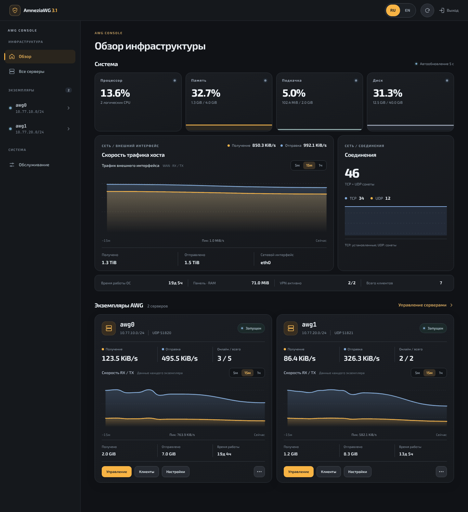

## Возможности

- **Только AmneziaWG 3.1.** Мастер собирает официальный модуль ядра (зафиксированный коммит) и утилиты (зафиксированный тег) и не продолжает работу с другой версией.
- **Случайная обфускация у каждого сервера.** `S1–S4`, `H1–H4`, `Jc`, размеры мусорных пакетов (`Jmin` 40–79, `Jmax` больше на 50–160), случайное дополнение пакетов данных (`ContentPaddingAddition`) и `HeaderProtectionKey` генерируются для каждого сервера, включая первый, и перегенерируются в панели.
- **Несколько независимых серверов** (`awg0`, `awg1`, … до 8), у каждого свои ключи, подсеть, UDP-порт и клиенты. По желанию у каждого нового сервера случайная подсеть `10.x.y.0/24`; клиента можно перенести на другой сервер с теми же ключами, владельцем, лимитами и подпиской.
- **Клиенты:** скачивание `.conf`, QR-код, ссылка `vpn://` для AmneziaVPN, комментарий, срок действия, лимит трафика (пожизненный или со сбросом каждый месяц), ограничение скорости, сети за клиентом (site-to-site), создание до 50 нумерованных клиентов разом с ZIP-архивом конфигураций, действия с отмеченными (включить, отключить, продлить, задать лимит, удалить), выгрузка списка в CSV, перевыпуск ключа одной кнопкой, группы и фильтры списка по группе и состоянию.
- **Переключатели трафика у каждого сервера:** клиенты видят друг друга или изолированы (в том числе от клиентов других серверов); доступ к частным сетям за сервером можно закрыть; службы самого сервера (SSH, панель) можно закрыть от клиентов; IPv6 клиентов можно направить в туннель и отбросить. Адреса сервиса метаданных облака закрыты для клиентов всегда. Сети за клиентом работают в любом положении.
- **Пометка устаревшей конфигурации:** в списке клиентов видно, кому нужен новый файл после изменения настроек.
- **Пакеты I1–I5:** кнопка «Сгенерировать» у каждого поля и готовые шаблоны для `I1` (случайные байты, DNS-запрос, STUN, пакет в форме QUIC). Если включить их с пустыми полями, `I1` создаётся автоматически.
- **Дополнительные строки [Interface]** для клиентов на роутере, в контейнере или Linux-шлюзе: `PostUp`, `PostDown`, `Table` и т. п. попадают в `.conf`, его QR-код и бота, но не в ссылку `vpn://`. Готовые шаблоны и применение сразу к нескольким клиентам.
- **Мониторинг:** процессор, память, подкачка, диск и трафик внешнего интерфейса, графики по каждому серверу, история за 30 дней, которую собирает systemd-таймер.
- **Резервные копии:** полные архивы с контрольными суммами, скачивание, расписание (ежедневно или еженедельно), срок хранения, восстановление с защитным снимком, проверка копий по расписанию (в том числе копии во внешнем хранилище); по желанию — шифрование паролем (OpenPGP), после чего бот присылает каждую новую копию в Telegram.
- **Мониторинг:** метрики для Prometheus по токену — серверы, клиенты, трафик, резервные копии.
- **Двухфакторный вход:** коды TOTP из любого приложения-аутентификатора в дополнение к паролю и 10 одноразовых резервных кодов на случай потери телефона.
- **Ключи доступа (passkeys):** вход по отпечатку пальца, лицу или PIN-коду устройства без пароля и кода; ключ не сработает на поддельном сайте.
- **Несколько учётных записей:** администраторы и наблюдатели (только просмотр, без ключей и конфигураций), имя учётной записи в журнале действий, список активных сессий с завершением любой из них.
- **Безопасная схема:** панель работает от непривилегированного пользователя на `127.0.0.1`; действия от root идут через один узкий список `sudo`, который обслуживает локальный помощник от root, поэтому страницы открываются быстро и при сотнях клиентов; строгий CSP, CSRF-токены, хеш пароля scrypt, журнал действий.
- **Telegram-бот (по желанию):** клиенты, конфигурации с QR-кодами, запуск и остановка серверов, резервные копии и уведомления — через собственный, более узкий список `sudo`.
- **Nginx по желанию:** обратный прокси с самоподписанным или вашим сертификатом.
- **Подписка для роутеров:** постоянная HTTPS-ссылка, по которой роутер или контейнер сам забирает актуальный `.conf` (с `ETag` и ответом 304, если ничего не менялось), и готовый скрипт для MikroTik, OpenWrt, Docker и Linux.
- **Если порт заблокировали:** профили маскировки (порт и `I1` в виде QUIC, STUN, DTLS или DNS), смена порта, обфускации и ключа сервера одной кнопкой или по расписанию, проверка входящих пакетов за 15 секунд в панели и в боте.
- **Владельцы:** один человек — несколько устройств на любых серверах, с общим трафиком (всего или в месяц), общим сроком и максимумом устройств; владелец сам добавляет устройство в Telegram-боте, если это разрешено.
- **Импорт клиентов** из wg-easy, 3x-ui, AmneziaVPN и любой конфигурации WireGuard — в панели с предпросмотром или командой `sudo awg31 import`.
- **Домен сервера:** в настройках сервера можно указать домен (например, `vpn.example.com`) и переключить «Адрес сервера в конфигурациях клиентов» на «Домен» — тогда в `Endpoint` клиентов, ссылке `vpn://`, QR-коде и подписке будет домен вместо IP. Это необязательно: по умолчанию остаётся IP. С доменом IP сервера можно сменить, не раздавая конфигурации заново, — достаточно поправить A-запись. После сохранения панель проверяет, что домен находится в DNS и указывает на IP из поля Endpoint, и предупреждает, если нет; бот присылает новые конфигурации владельцам.
- **Сеть сервера:** подгонка TCP под MTU туннеля (clamp MSS) на сервере и защитные настройки ядра (`rp_filter`, без ICMP-перенаправлений, SYN cookies).

## Требования

| | |
|---|---|
| ОС | Ubuntu 24.04 / 26.04 LTS, Rocky Linux 9 / 10 |
| Процессор | x86_64 или aarch64 |
| Доступ | root, интерактивный терминал, исходящий доступ к GitHub и PyPI |
| Сеть | публичный IPv4-адрес (или DNS-имя) и свободный UDP-порт |

Установщику нужны заголовки ядра, совпадающие с работающим ядром. Secure Boot можно не отключать: мастер попросит зарегистрировать ключ DKMS (MOK) из консоли сервера после перезагрузки.

## Быстрый старт

Запускайте от root (если вы не root, сначала `sudo -i`):

```bash
bash <(curl -Ls https://raw.githubusercontent.com/stepm65/amneziawg31-installer/main/install.sh)
```

Чтобы установить конкретную версию, добавьте её тег (например, `v0.9.6`):

```bash
bash <(curl -Ls https://raw.githubusercontent.com/stepm65/amneziawg31-installer/main/install.sh) v0.9.6
```

Чтобы установить текущую сборку из ветки `main` (это не релиз), укажите `dev-latest`:

```bash
bash <(curl -Ls https://raw.githubusercontent.com/stepm65/amneziawg31-installer/main/install.sh) dev-latest
```

Без root-оболочки тот же установщик запускается так: `curl -Ls https://raw.githubusercontent.com/stepm65/amneziawg31-installer/main/install.sh | sudo bash` (для версии добавьте `-s -- v0.9.6`).

Установщик собирает модуль ядра и утилиты, затем запускает мастер. В терминале он показывает экраны (whiptail): выбор языка (русский или английский), приветствие с найденными системой, интерфейсом и адресом, затем **один экран со всеми параметрами** — стрелками выбираете пункт, Enter открывает его, значения по умолчанию подходят для большинства серверов. Подсеть (стандартная, случайная или своя), DNS (Cloudflare, Google, Quad9, AdGuard или свой), режим трафика, внешний интерфейс и вариант HTTPS выбираются из списков. Ничего не меняется, пока вы не нажмёте **«Установить»**: тогда мастер проверяет все значения (порты, пересечение подсети с маршрутами, сертификаты) и показывает, что не так, не выходя из экрана. Дальше идёт полоса прогресса, а подробный вывод пишется в `/var/log/awg31-install.log` — при ошибке мастер покажет его последние строки.

Без whiptail (на Rocky Linux он ставится сам из пакета `newt`), без терминала или с `AWG31_UI=text` мастер задаёт те же вопросы обычным текстом; у каждого есть значение по умолчанию, достаточно нажимать Enter:

1. Подсеть VPN (`/24`…`/29`, по умолчанию `10.77.10.0/24`), UDP-порт, MTU.
2. Публичный IPv4 сервера, необязательный **домен** для конфигураций клиентов вместо IP (при смене IP тогда достаточно поправить A-запись; мастер предупредит, если домен не указывает на сервер), DNS для клиентов.
3. Режим трафика: **full** (весь IPv4 клиента через VPN, NAT на сервере) или **split** (только подсеть VPN).
4. Локальный TCP-порт панели и имя первого клиента.
5. Обратный прокси: без него, Nginx с самоподписанным сертификатом или Nginx с вашим сертификатом.
6. Пароль администратора: введите свой (дважды, не короче 12 символов) или нажмите Enter, и случайный пароль будет создан и показан один раз в конце.

Сгенерированный пароль записывается в `/root/awg31-initial-password.txt` (доступен только root) и на экран не выводится. Если активен ufw или firewalld, мастер предложит открыть в нём порт VPN.

После установки выполните `sudo awg31`, чтобы увидеть команды управления: состояние, обновление, резервные копии, сброс пароля, порт панели, настройка Nginx, удаление и другие.

Каждый релиз публикуется вместе с файлом `.sha256`. И `install.sh`, и `awg31 update` сверяют архив с этой суммой и прерываются при несовпадении, до распаковки. Сумма защищает от повреждённой или оборванной загрузки; она берётся с той же страницы релиза, что и архив. `dev-latest` не является релизом и по сумме не проверяется. Начиная с 0.29 у архива есть и **аттестация GitHub** — подписанное доказательство, что он собран workflow этого репозитория из конкретного коммита: `gh attestation verify awg31-console-vX.Y.Z.tar.gz --repo stepm65/amneziawg31-installer`. С `AWG31_ATTESTATION=require` установщик проверяет её сам (нужен `gh`, выполнивший вход) и без неё ничего не ставит.

Перед установкой на сервер, который уже чем-то занят, сделайте snapshot VPS и сохраните доступ к консоли. После установки откройте UDP-порт в файрволе провайдера.

Если Nginx не ставили, заходите в панель через SSH-туннель:

```bash
ssh -L 8080:127.0.0.1:8080 root@ваш-сервер
# затем откройте http://localhost:8080
```

Если страница входа открывается снова и снова, браузер не принимает защищённую cookie по обычному HTTP: используйте для туннеля Chrome или Firefox либо настройте Nginx (`sudo awg31 nginx`).

Хотите сначала прочитать код? Клонируйте репозиторий и выполните в нём `sudo bash install.sh`: результат тот же.

### Установка без вопросов

Для автоматизации задайте `AWG31_UNATTENDED=1`: вопросы не задаются, используются значения по умолчанию, если переменная их не переопределяет.

```bash
curl -Ls https://raw.githubusercontent.com/stepm65/amneziawg31-installer/main/install.sh | \
  sudo env AWG31_UNATTENDED=1 AWG31_ENDPOINT=vpn.example.com AWG31_PORT=51820 bash
```

| Переменная | По умолчанию |
|---|---|
| `AWG31_SUBNET` | `10.77.10.0/24` |
| `AWG31_RANDOM_SUBNET` | `0`; `1` — случайная `10.x.y.0/24` (если `AWG31_SUBNET` не задана) |
| `AWG31_PORT` | `51820` |
| `AWG31_MTU` | `1280` |
| `AWG31_ENDPOINT` | определённый публичный IPv4 |
| `AWG31_ENDPOINT_DOMAIN` | пусто; домен сервера, который попадёт в конфигурации клиентов вместо IP |
| `AWG31_ADMIN_NAME` | `admin`; имя для входа в веб-панель (a–z, 0–9, точка, _ и -, с буквы) |
| `AWG31_DNS` | `1.1.1.1` |
| `AWG31_MODE` | `full` |
| `AWG31_UPLINK` | интерфейс маршрута по умолчанию |
| `AWG31_PANEL_PORT` | `8080` |
| `AWG31_FIRST_CLIENT` | `test-client` (`skip` — не создавать) |
| `AWG31_PASSWORD_FILE` | нет: пароль генерируется в `/root/awg31-initial-password.txt` |
| `AWG31_OPEN_FIREWALL` | `yes`: открыть UDP-порт в активном ufw/firewalld |
| `AWG31_NGINX_CHOICE` | `0` (без Nginx); для `1`/`2` нужен ещё `AWG31_NGINX_HOST`, для `2` — `AWG31_NGINX_CERT`, `AWG31_NGINX_KEY` |
| `AWG31_TELEGRAM_TOKEN`, `AWG31_TELEGRAM_ADMINS` | не заданы: без бота (см. [Telegram-бот](#telegram-бот)) |

## Панель

| Клиенты | Экспорт |
|---|---|
| 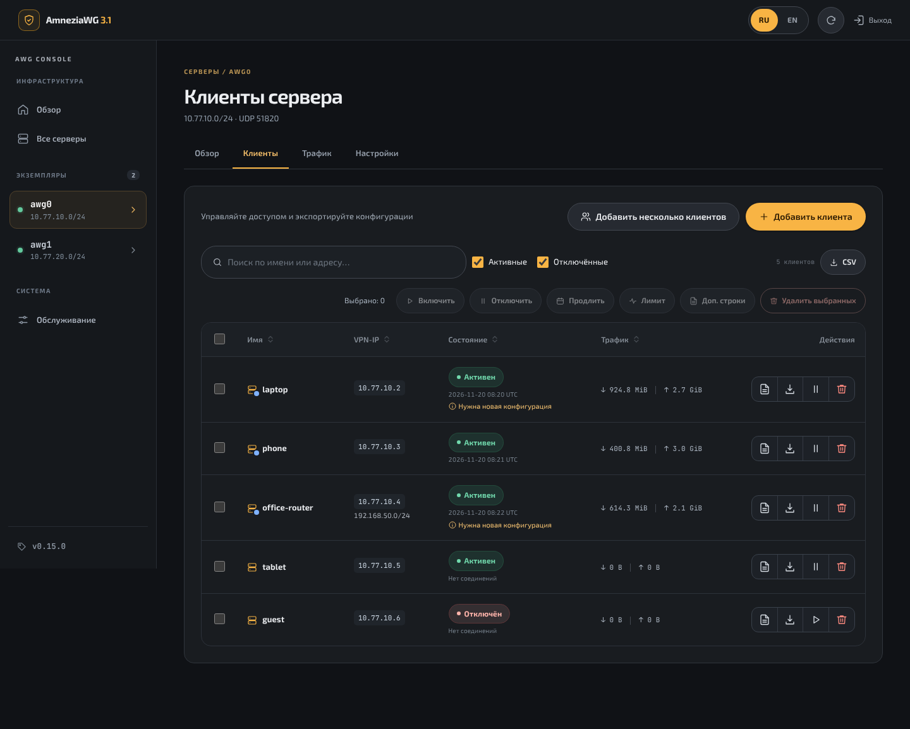 | 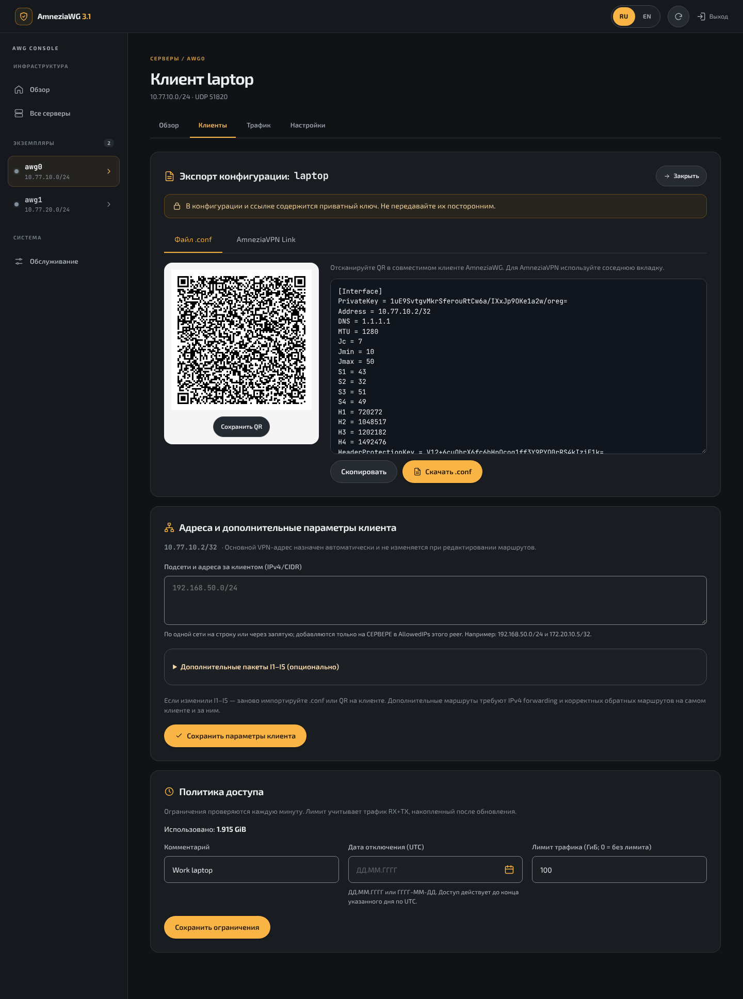 |

| Трафик | Настройки сервера |
|---|---|
| 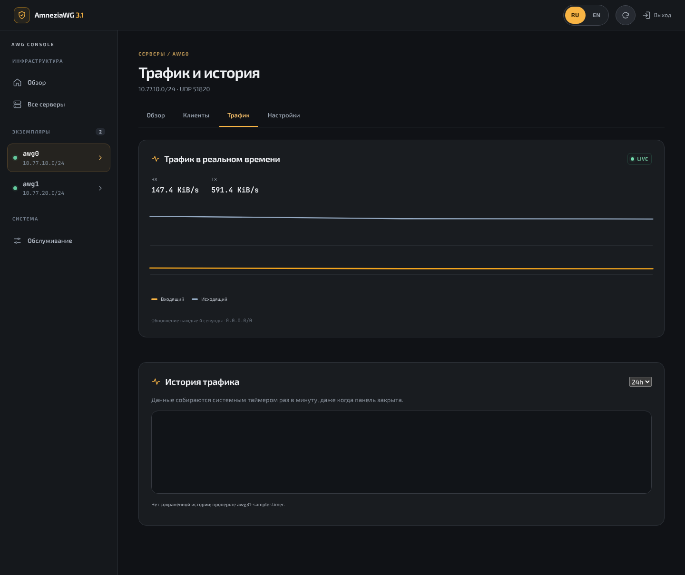 | 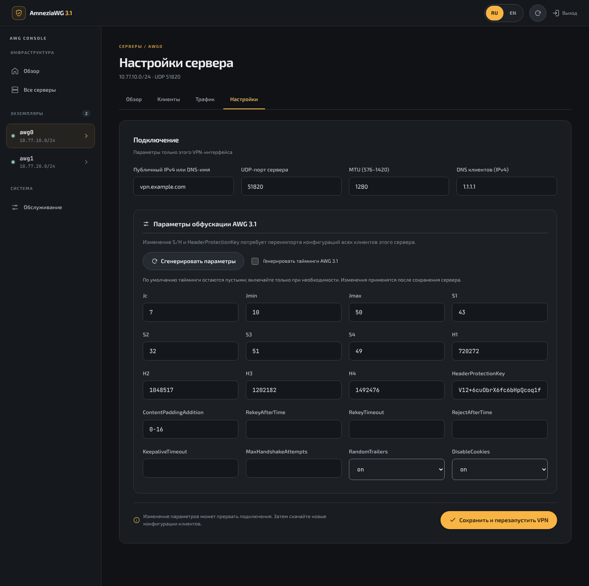 |

| Редактор I1–I5 | Резервные копии |
|---|---|
| 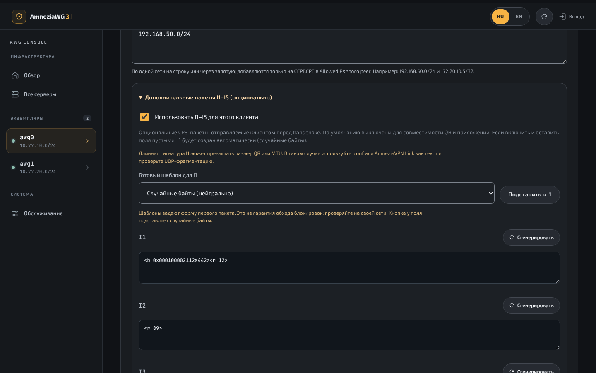 | 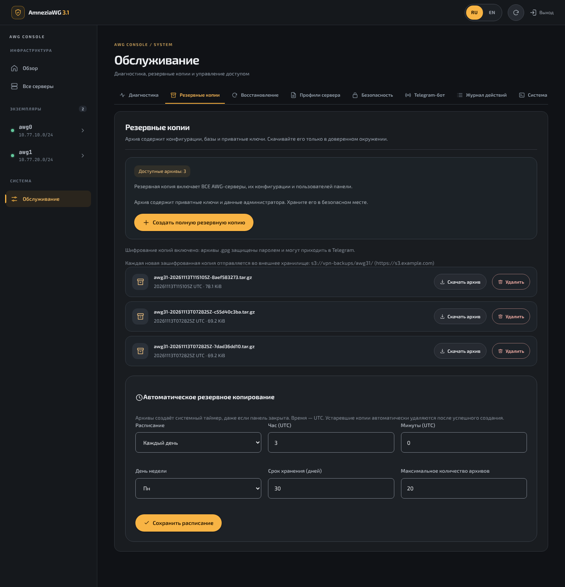 |

| Двухфакторный вход | Telegram-бот |
|---|---|
| 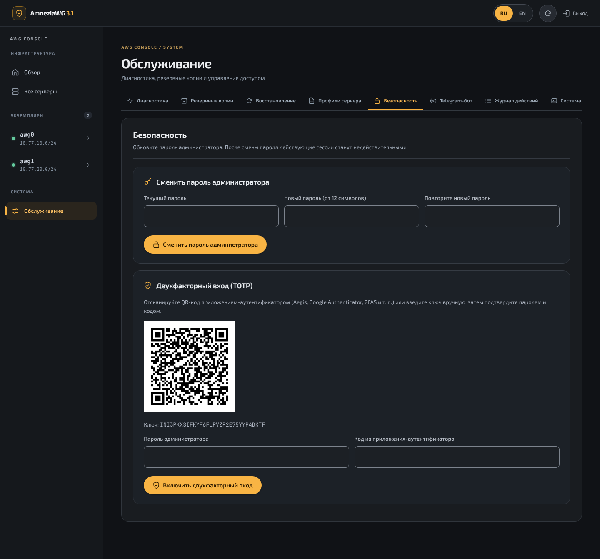 | 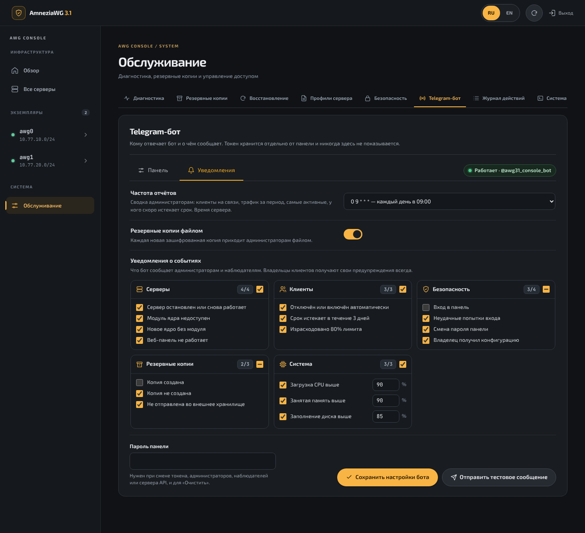 |

| Журналы | История подключений |
|---|---|
| 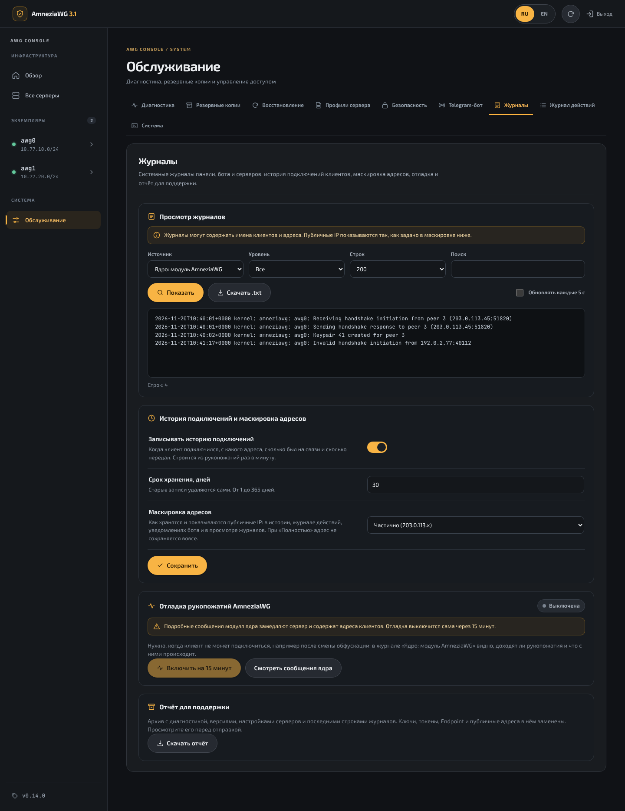 | 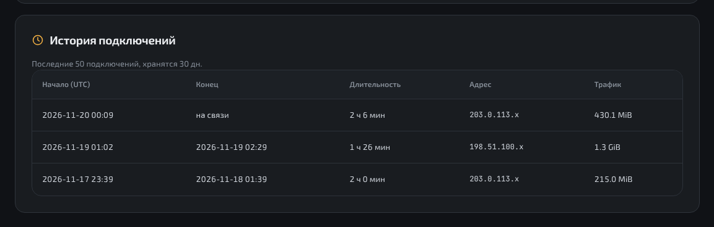 |

На скриншотах демонстрационные данные.

### Журналы

Сам AmneziaWG ничего не пишет о подключениях, а панель работает без журнала запросов. Раздел **«Обслуживание → Журналы»** собирает то, что есть:

- **Просмотр журналов:** панель, бот, помощник, опрос клиентов, резервные копии, проверка нового ядра, служба `awg-quick@` каждого сервера и сообщения модуля ядра AmneziaWG — по уровню, числу строк и тексту, с обновлением каждые 5 секунд или выгрузкой в `.txt`. Читать можно только журналы из этого списка.
- **История подключений** (по умолчанию выключена): строится раз в минуту из рукопожатий — когда клиент подключился, с какого адреса, сколько был на связи и сколько передал. Показывается на странице клиента; хранится от 1 до 365 дней (по умолчанию 30).
- **Маскировка публичных адресов**, как в 3x-ui: не скрывать (`203.0.113.45:51820`), частично (`203.0.113.x`, по умолчанию) или полностью (`IP-3f2a1c` — метка, по которой адрес не восстановить). Действует на историю подключений, журнал действий (попытки входа), уведомления бота и просмотр журналов, причём в момент записи: при полной маскировке адрес не сохраняется вовсе. Адреса в туннеле и частные адреса не меняются.
- **Отладка рукопожатий** включает подробные сообщения модуля ядра AmneziaWG на 15 минут и сама их выключает — для клиента, который не может подключиться, например после смены обфускации.
- **Отчёт для поддержки:** один архив с диагностикой, версиями, настройками серверов и последними строками журналов. Ключи, токены, строки `Endpoint` и публичные адреса в нём заменены; просмотрите его перед отправкой.
- **Срок хранения трафика и базы данных:** поминутная история трафика серверов хранится 32 дня, почасовой трафик клиентов — 62 дня; оба срока меняются от 7 до 730 дней. Старые записи удаляются сами, а раз в неделю (в 03:xx UTC) базы сжимаются (`VACUUM`), чтобы файлы не росли. Блок «Базы данных» показывает размер каждой базы и время сжатия, кнопка «Сжать сейчас» делает это сразу (`sudo awg31 db-vacuum`).

**Журнал действий** теперь листается по страницам, фильтруется по событию, датам и тексту, выгружается в CSV и читает в том числе архивные файлы после ротации.

### Проверка резервных копий

Копия, из которой нельзя восстановиться, хуже, чем никакой. Поэтому после резервной копии по расписанию панель её проверяет — раз в неделю (по умолчанию) или каждую; это настраивается в расписании копий. Проверка открывает архив так же, как восстановление: расшифровка, контрольные суммы, целостность баз SQLite. Если настроено внешнее хранилище (S3 или SFTP), оттуда скачивается та же копия и сравнивается байт в байт — так видно, что она действительно туда дошла и не повреждена. Результат виден в «Обслуживание → Резервные копии», там же кнопка «Проверить последнюю копию»; при ошибке бот присылает уведомление (событие «Проверка копии не пройдена»). Из консоли: `sudo awg31 backup-verify [ИМЯ]`.

### Мониторинг: метрики для Prometheus

Для тех, у кого уже есть Prometheus и Grafana. В «Обслуживание → Мониторинг» включается адрес `/metrics` в формате Prometheus: серверы (работает ли интерфейс, порт), клиенты по состоянию и на связи (рукопожатие за 3 минуты), трафик серверов и каждого клиента, использованная квота, время последнего рукопожатия, число резервных копий, время последней и результат проверки, число сессий панели. Ключей и конфигураций там нет; метрики по каждому клиенту (с именами клиентов в метках) можно выключить.

Доступ — только с токеном `Authorization: Bearer …`: он показывается один раз при включении (в панели хранится только хеш), его можно перевыпустить. Без включения адрес отвечает 404, с неверным токеном — 401, и такие попытки ограничиваются по частоте. Включение и выключение требуют пароля панели. Через HTTPS (`sudo awg31 nginx`) метрики доступны снаружи — если задан список разрешённых адресов, добавьте в него адрес Prometheus. Пример для `prometheus.yml` показан на той же странице:

```yaml
scrape_configs:
  - job_name: awg31
    scheme: https
    authorization:
      credentials: <токен>
    static_configs:
      - targets: ['vpn.example.com:8443']
```

### Шаблоны I1–I5

| Шаблон | Что отправляется перед handshake |
|---|---|
| Случайные байты | один пакет из 40–119 случайных байт |
| DNS-запрос | корректный запрос A-записи популярного домена со случайным ID |
| STUN Binding Request | запрос из 20 байт по RFC 5389 со случайным идентификатором |
| DTLS 1.2 ClientHello | первый пакет звонка WebRTC (с расширением `use_srtp`), поле random каждый раз новое |
| QUIC Initial с ClientHello | полный пакет QUIC v1 Initial на 1200 байт с TLS 1.3 ClientHello и выбранным именем сервера (SNI); расшифровывается как настоящий QUIC, в тестах его принимает реальная серверная реализация QUIC |
| QUIC Initial, только форма | тот же заголовок и размер, случайное содержимое и случайный идентификатор при каждой отправке; короткая запись, помещается в QR, но как QUIC не расшифровывается |

Короткая запись не значит маленький пакет: `<r 1000>` — это 1000 случайных байт в сети. Шаблон с ClientHello записывается hex-строкой из 2400 символов, одинаков при каждом подключении и не помещается в QR-код, поэтому передавайте клиенту файл `.conf`. Можно вставить и собственный записанный пакет в виде `<b 0x…>`.

Шаблоны задают только форму первых пакетов. Помогут ли они против конкретного фильтра, зависит от сети, поэтому проверяйте там, где пользуетесь VPN. После изменения I1–I5 заново импортируйте конфигурацию на клиенте.

### Расписание доступа

На странице клиента в блоке ограничений есть **«Расписание доступа»**: дни недели, время «с» и «до» и часовой пояс (по умолчанию — пояс сервера). Вне этого времени клиент отключается сам (в списке — «Вне расписания», фильтр «С расписанием») и включается обратно, как только время наступит; проверка идёт раз в минуту вместе с лимитами. Окно может переходить через полночь, например 22:00–07:00 — тогда дни означают, в какие дни оно начинается. Если клиент за это время истёк или выбрал лимит, расписание его не включит. Если расписание убрать, остановленный им клиент сразу включается. Владелец видит расписание на своём экране в боте.

### Группы, фильтры, действия с отмеченными и CSV

У клиента можно указать **группу** («офис», «семья» и т. п.) — в форме создания, на странице клиента или сразу для отмеченных кнопкой **«Группа»**. Группа показывается рядом с именем. Над списком есть отметки «Все», «Онлайн», «Не в сети», «Отключены», фильтр по группе (в том числе «Без группы») и по признаку — срок истекает за 3 дня, нужна новая конфигурация, роутеры с подпиской, с владельцем в Telegram. Поиск ищет и по группе, и по комментарию. Флажок «выбрать всех» отмечает только видимые строки, поэтому группу удобно отфильтровать и продлить, отключить или перенастроить целиком.

Отметьте клиентов в списке: над таблицей появятся кнопки **«Включить»**, **«Отключить»**, **«Продлить»**, **«Лимит»**, **«Группа»**, **«Доп. строки»** и **«Удалить выбранных»**. Продление отсчитывается от текущего срока, у истёкших — от сегодня; клиенты без срока не меняются. Клиенты, отключённые из-за срока или лимита, после продления или нового лимита включаются сами. Над списком остаётся отчёт: сколько клиентов изменено и кого пропустили и почему (уже в нужном состоянии, истёк срок, исчерпан лимит, без срока).

Кнопка **CSV** выгружает список клиентов сервера: имя, адрес, состояние, комментарий, срок, лимит и расход, последнее соединение, ограничение скорости, владелец. Ключей в файле нет; значения, которые таблица приняла бы за формулу, записываются как текст. Каждая выгрузка попадает в журнал действий.

### Дополнительные строки [Interface]

Клиент, который сам поднимает туннель через `awg-quick` (роутер, контейнер на MikroTik или OpenWrt, Docker, Linux-шлюз), часто требует своих команд в конфигурации. На странице клиента в блоке «Дополнительные строки [Interface]» их можно задать один раз, и они будут в каждом скачанном `.conf`, в его QR-коде и в файле от бота. В ссылку `vpn://` они не попадают: приложения AmneziaVPN такие команды не выполняют. Команды выполняются на клиенте, а не на сервере.

Разрешены `PreUp`, `PostUp`, `PreDown`, `PostDown`, `Table` и строки-комментарии с `#`. Разделы и параметры, которые задаёт панель (`Address`, `DNS`, `MTU`, `AllowedIPs`, обфускация, `I1`–`I5`), добавить нельзя; символ `#` внутри команды тоже: `awg-quick` принял бы остаток строки за комментарий.

Меню «Вставить шаблон ▾»:

| Шаблон | Что добавляет |
|---|---|
| Шлюз для локальной сети | NAT в туннель, clamp MSS, `Table = 200` и правило, которое направляет трафик из локальной сети в туннель. Интерфейс локальной сети находится сам при подъёме туннеля (интерфейс маршрута по умолчанию, иначе единственный, кроме `lo` и туннеля), поэтому один шаблон подходит для нескольких контейнеров с разными `veth`. |
| Только clamp MSS | подгонку TCP-пакетов под MTU туннеля |
| Только NAT | маскарадинг трафика, который уходит в туннель |

Чтобы задать одни и те же строки нескольким клиентам, отметьте их в списке и нажмите «Доп. строки»: строки можно заменить или добавить к уже заданным, одинаковые команды панель хранит один раз, даже если шаблоны пересекаются (в «Шлюз» уже входят NAT и clamp MSS). У таких клиентов в списке синяя точка на значке, после изменения им нужен новый `.conf`.

### Подписка для роутеров

Роутер или контейнер, который поднимает туннель через `awg-quick`, может сам забирать свою конфигурацию. На странице клиента в блоке «Подписка для роутера» нажмите **«Включить подписку»**: панель один раз покажет ссылку вида `https://ваш-адрес/sub/awg0/…` и скрипт `awg-sub.sh` (его можно скопировать или скачать). В панели хранится только отпечаток ссылки; потерянную ссылку нельзя показать снова — выпустите новую, прежняя перестанет работать сразу.

Ссылка отдаёт текущий `.conf` клиента вместе с дополнительными строками `[Interface]`. Если с прошлого запроса ничего не менялось, сервер отвечает `304 Not Modified`. Скрипт запускают раз в 5 минут по cron (`*/5 * * * * sh /etc/amnezia/awg-sub.sh`) или фоном (`sh awg-sub.sh --loop`): новый файл он проверяет, сохраняет прежний в `.bak`, перезапускает туннель и возвращает старый файл, если новый не поднялся. Если рукопожатий нет дольше 3 минут, скрипт на время опускает туннель и спрашивает ссылку напрямую — это помогает, когда туннель забирает маршрут по умолчанию. Для самоподписанного сертификата в скрипт встроен отпечаток его ключа (`curl --pinnedpubkey`).

Подписка работает только через HTTPS-адрес панели (`sudo awg31 nginx`): ссылка содержит закрытый ключ клиента. Адрес `/sub/` открыт для всех адресов, даже если панель пускает только с выбранных, но ограничен по частоте (Nginx и сама панель; после 10 неверных ссылок адрес ждёт 15 минут). Отключённый клиент получает ответ 403. Время и адрес последнего запроса видны на странице клиента.

### Одноразовая ссылка для человека без Telegram

На странице клиента в блоке «Одноразовая ссылка» выберите срок (1 час, 24 часа, 3 или 7 дней) и сколько раз её можно открыть (1 или 3) и нажмите **«Создать ссылку»**. Панель один раз покажет ссылку вида `https://ваш-адрес/sub/once/awg0/…` — отправьте её любым способом. Человек открывает её в браузере, нажимает «Показать конфигурацию» и получает QR-код, файл `.conf`, текст конфигурации и ссылку `vpn://` с короткой инструкцией. Первый экран ничего не тратит, поэтому предпросмотр ссылки в мессенджере её не «съест»; открытие считается только по кнопке. После последнего открытия или по истечении срока ссылка не работает; новую можно выпустить в любой момент (прежняя сразу перестаёт работать) или отозвать. Как и подписка, ссылка работает только через HTTPS-адрес панели, хранится только её отпечаток, а частота запросов ограничена. Создание, открытие (с адресом) и отзыв попадают в журнал действий.

### График трафика клиента

На странице клиента есть график скачивания и отдачи за 24 часа, 7 дней или 30 дней. Данные собираются по часам вместе с обычным учётом трафика и хранятся 62 дня; при удалении клиента удаляются.

### Если порт заблокировали

В **«Настройки сервера → Маскировка и смена параметров»**:

- **Профиль маскировки** переводит сервер на порт профиля и записывает всем клиентам `I1` одного вида: QUIC (443), STUN (3478), DTLS 1.2 как у звонков WebRTC (8801), DNS-запрос (53) или запрос к игровому серверу Steam (27015). В профиле «Свой» порт и пакет `I1` задаются вручную. Содержимое каждый раз случайное, повторяется только форма пакета. Профиль не гарантирует обход блокировок: проверяйте в той сети, где пользуетесь VPN. Новые клиенты получают `I1` профиля сами.
- **Сменить сейчас** — новый случайный порт 20000–59999, новые `S1–S4`, `H1–H4`, ключ заголовков и `Jc`, по желанию новый ключ сервера и новые ключи клиентов с подпиской (роутеры заберут их сами). Клиенты, их адреса, ключи (кроме выбранных) и лимиты сохраняются; ваши `Jmin/Jmax`, тайминги, `RandomTrailers` и `DisableCookies` тоже. В ufw и firewalld новый порт открывается сам, в облачном файрволе — вами.
- **По расписанию** — то же раз в 1, 3, 7, 14 или 30 дней. Удобно, когда клиенты — роутеры с подпиской: они подхватывают новые параметры сами. Телефоны и компьютеры без подписки после смены отключатся до нового импорта.

Перед каждой сменой сохраняется копия настроек сервера. Смены записываются в журнал, бот сообщает о них администраторам (событие «Смена параметров сервера»), а в меню сервера в боте есть кнопка «🔀 Сменить порт».

После смены параметров, профиля маскировки, переноса клиента или настроек сервера, которые меняют конфигурации клиентов (адрес, порт, DNS, MTU, обфускация), бот сам присылает владельцам новую конфигурацию (файл и QR-код), если у клиента указан владелец и ему разрешено получать конфигурацию. Владельцы без такого права получают сообщение, что нужно попросить новую у администратора. Роутеры с подпиской и отключённые клиенты сообщений не получают.

### Владельцы и общие лимиты

Раздел **«Владельцы»** в боковом меню. Владелец — это человек, у которого может быть несколько устройств (клиентов) на любых серверах. У владельца есть имя, необязательный Telegram ID и общие лимиты:

- **общий трафик** — на все устройства вместе, всего или в месяц (сбрасывается первого числа по UTC);
- **общий срок** — одна дата для всех устройств;
- **максимум устройств** — сколько клиентов может у него быть.

Израсходован трафик или истёк срок — отключаются все устройства владельца (в списке: «Общий лимит владельца»), включить их по одному нельзя. Когда лимит снова позволяет (новый месяц, больше трафика, продлён срок), устройства включаются сами. Свои лимиты клиента продолжают действовать: срабатывает тот, что наступит раньше.

Владельца выбирают в форме нового клиента, на странице клиента или сразу для отмеченных кнопкой **«Владелец»**; на странице владельца видны все его устройства и есть кнопка **«Добавить устройство»**. Telegram ID задаётся у владельца и переходит на все его устройства. Клиенты, у которых до обновления был указан Telegram ID, сами собираются во владельцев «Telegram <ID>» — их можно переименовать. Приглашение в бот тоже делает человека владельцем (с его именем из Telegram). Удаление владельца не удаляет устройства, а только отвязывает их.

Если у владельца задан максимум устройств и включено **«Владелец может сам добавлять устройства в боте»**, у него в боте появляется кнопка **«➕ Добавить устройство»**: он выбирает тип (телефон, компьютер, планшет, роутер, телевизор) и сразу получает `.conf` и QR-код. Устройство создаётся на сервере, выбранном у владельца, администраторам приходит сообщение. В боте владелец видит и общий остаток: «Общий трафик: 38 GiB из 100 GiB (в месяц)».

Владельцы хранятся в `/var/lib/awg31-panel/owners.sqlite3` и входят в резервные копии.

### Импорт клиентов из других панелей

**«Обслуживание → Импорт клиентов»**: выберите файлы, сервер и нажмите «Прочитать и показать» — панель покажет найденных клиентов, ничего не меняя; снимите лишние отметки и нажмите «Импортировать».

| Откуда | Какие файлы |
|---|---|
| wg-easy 15 | `/etc/wireguard/wg-easy.db` |
| wg-easy 14 и старше | `/etc/wireguard/wg0.json` |
| 3x-ui | `/etc/x-ui/x-ui.db` — подключения WireGuard и AmneziaWG, клиенты и их устройства |
| AmneziaVPN (свой сервер) | из контейнера `amnezia-awg`: `/opt/amnezia/awg/awg0.conf` (или `wg0.conf`) и `/opt/amnezia/awg/clientsTable` — оба файла вместе |
| любой сервер WireGuard | `wg0.conf` с блоками `[Peer]`; имя берётся из комментария над пиром (`# Client: …`, `### Client …`) |

Переносятся имя (приводится к латинице: «Мама» → `Mama`), ключи и PSK, если они есть в файле, адрес — если попадает в подсеть сервера и свободен, включён ли клиент, срок, лимит трафика, комментарий, группа и Telegram ID. Клиент 3x-ui с несколькими устройствами становится **владельцем** с общим трафиком, сроком и максимумом устройств, а устройства — его клиентами. Клиенты с Telegram ID тоже получают владельца. Ключ, который уже есть на сервере, второй раз не переносится.

AmneziaVPN хранит приватные ключи только на устройствах, поэтому его клиенты получают новые ключи. Но и с сохранёнными ключами всем перенесённым клиентам нужна **новая конфигурация**: у сервера AWG 3.1 свои ключ и параметры обфускации. Раздайте её файлом, QR-кодом, подпиской или через бота.

Из консоли, например для большого файла: `sudo awg31 import --server awg0 x-ui.db` (`--new-keys` — выдать новые ключи, `--yes` — без вопроса). Через Nginx файлы принимаются до 64 МиБ (только по адресу импорта); файлы читаются в памяти и не сохраняются.

### Перенос клиента на другой сервер

На странице клиента в блоке «Перенос на другой сервер» выберите сервер и нажмите «Перенести». Клиент переезжает с теми же ключами, комментарием, владельцем, сроком, лимитами, расходом трафика, пакетами `I1–I5`, дополнительными строками, подпиской и действующим приглашением и получает свободный адрес в подсети нового сервера. Если на новом сервере уже есть клиент с таким именем или ключом, перенос не выполняется. Клиенту нужна новая конфигурация: ссылка-подписка продолжает работать и отдаёт её с нового сервера, владельцу с правом получения её пришлёт бот.

### Сигнал о блокировке

В том же разделе настроек — **«Сигнал о блокировке»**. Если два и больше клиента были подключены и все пропали одновременно, а рукопожатий нет дольше выбранного времени (15, 30, 60 или 120 минут, по умолчанию 30), на странице сервера появляется предупреждение, а бот сообщает администраторам (событие «Клиенты пропали все сразу»). Когда клиенты подключаются снова, бот сообщает и об этом. Один ушедший клиент или остановленный сервер сигналом не считаются. По желанию сервер сам меняет порт и обфускацию в момент сигнала: роутеры с подпиской подхватят новые параметры, владельцам с правом получения бот пришлёт новые файлы.

### Проверка входящих пакетов

Кнопка **«Проверить входящие пакеты (15 с)»** на странице сервера (и «📡 Пакеты 15 с» в боте) 15 секунд слушает UDP-порт сервера. Включите VPN на клиенте сразу после нажатия. Ни одного пакета — трафик не доходит до сервера (облачный файрвол или блокировка у провайдера); пакеты доходят, но сервер не отвечает — у клиента другие ключи или обфускация; есть и то и другое — сеть в порядке, ищите причину на клиенте. Показываются размеры пакетов и адреса отправителей (с маскировкой, как в журналах).

## Консоль сервера

Что делать, если не открывается панель, забыт пароль, потерян телефон с кодами, не поднялся VPN после смены ядра или заблокировали IP, — в руководстве [docs/TROUBLESHOOTING.ru.md](docs/TROUBLESHOOTING.ru.md). Что нового в каждой версии — [CHANGELOG.ru.md](CHANGELOG.ru.md).

```text
sudo awg31 status           панель и экземпляры VPN
sudo awg31 update [VER]     обновить до последнего релиза, vX.Y.Z или dev-latest
sudo awg31 rollback         вернуть версию до последнего обновления (list — снимки, delete ИМЯ — удалить снимок, --yes — без вопроса)
sudo awg31 version          установленная версия
sudo awg31 servers          настроенные интерфейсы
sudo awg31 doctor           проверка ядра, DKMS и интерфейса
sudo awg31 backup           создать полную резервную копию
sudo awg31 backups          список резервных копий
sudo awg31 restore-check N  проверить архив
sudo awg31 backup-verify [N] проверить последнюю (или указанную) копию и её копию во внешнем хранилище
sudo awg31 db-vacuum        сжать базы данных сейчас
sudo awg31 restore N        восстановить архив (VPN перезапустится)
sudo awg31 reset-password   задать новый пароль панели (и при желании имя для входа)
sudo awg31 totp-off         отключить двухфакторный вход (потерян аутентификатор)
sudo awg31 backup-encryption on|off|status|change   шифровать копии паролем
sudo awg31 backup-remote s3|sftp|test|status|off    отправлять каждую новую копию в S3 или по SFTP
sudo awg31 port N           сменить локальный TCP-порт панели
sudo awg31 uninstall        удалить консоль; с --purge удаляются и данные VPN
sudo awg31 nginx            настроить HTTPS-прокси Nginx
sudo awg31 telegram         подключить Telegram-бота (status | test | off)
sudo awg31 restart-panel    перезапустить только веб-панель
sudo awg31 logs             журнал панели
```

## Telegram-бот

По желанию. Бот управляет клиентами и серверами из Telegram и сообщает о событиях. Он сам опрашивает Telegram, поэтому входящий порт не открывается.

```bash
sudo awg31 telegram          # подключить: спросит токен от @BotFather и определит ваш Telegram ID
sudo awg31 telegram status   # работает ли бот и кому он отвечает
sudo awg31 telegram test     # отправить тестовое сообщение
sudo awg31 telegram off      # остановить бота и удалить токен с сервера
```

В панели: **«Обслуживание → Telegram-бот»**. Вставьте токен и, как в 3x-ui, числовые Telegram ID администраторов через запятую (свой ID покажет @userinfobot) — бот подключится сразу. Если поле ID оставить пустым, отправьте новому боту `/start` в личном чате: панель найдёт отправителя и попросит подтвердить его. Наблюдателей, язык, свой сервер Bot API и уведомления можно поменять после подключения.

| Бот умеет | Только в панели или консоли |
|---|---|
| создать клиента и прислать его `.conf` и QR-код | удалить сервер, создать сервер |
| включить, отключить, удалить клиента; задать срок и лимит | менять настройки сервера, обфускацию, сети клиента |
| показать серверы, клиентов, трафик, состояние модуля ядра и панели | восстановить, скачать или удалить резервную копию |
| запустить, остановить, перезапустить сервер | сменить пароль панели |
| создать резервную копию | |

Уведомления (каждую группу можно отключить при настройке): сервер остановился или снова работает, модуль ядра не загружен, служба панели остановилась; клиент отключён по сроку или лимиту, срок клиента истекает в ближайшие три дня; вход в панель, неудачные попытки входа, смена пароля; создана резервная копия или копия по расписанию не создалась.

Администраторы — только перечисленные числовые Telegram ID и только в личном чате; кроме владельцев клиентов (ниже), остальным бот не отвечает совсем. Удаление клиента и остановка сервера требуют подтверждения. Всё, что сделано через бота, попадает в журнал действий вместе с Telegram ID.

### Роли, сводка и настройки в панели

Раздел **«Обслуживание → Telegram-бот»** в панели состоит из двух вкладок.

- **Панель:** включить и выключить бота (токен и настройки сохраняются), заменить токен (поле никогда не показывает текущий; **«Очистить»** отключает бота и удаляет токен), администраторы и **наблюдатели**, язык бота, свой [сервер Bot API](https://core.telegram.org/bots/api#using-a-local-bot-api-server) вместо api.telegram.org и **«Отправить тестовое сообщение»**. Наблюдатели видят те же экраны и получают уведомления, но у них нет кнопок действий и изменить они ничего не могут. Свой числовой ID любой человек узнает, отправив боту `/id` в личном чате.
- **Уведомления:** как часто приходит **отчёт** (каждый час, каждые 6 или 12 часов, каждый день, по понедельникам или любая строка crontab, например `30 8 * * 1-5`; время сервера): серверы, клиенты на связи, трафик с прошлого отчёта, самые активные клиенты, у кого срок истекает в течение недели и кто не подключался месяц. Ниже — **резервные копии файлом** и карточки групп событий — серверы, клиенты, безопасность, резервные копии, система — у каждого события свой флажок. Карточка «Система» предупреждает, когда загрузка процессора держится выше порога три минуты или память либо диск заняты выше порога, и ещё раз, когда значение вернулось ниже.

Новый токен, другие администраторы или наблюдатели, другой сервер API и **«Очистить»** снова спрашивают пароль панели.

Когда включено шифрование копий (`sudo awg31 backup-encryption on`) и включены **резервные копии файлом**, каждая новая копия приходит администраторам файлом `.gpg`. Незашифрованные архивы не отправляются никогда.

### Владельцы клиентов

Проще всего — **приглашение**. На странице клиента в блоке «Доступ: приглашение и ключ» (или кнопкой **«Пригласить»** у клиента в боте) создайте одноразовую ссылку вида `https://t.me/<бот>?start=<код>` и перешлите её человеку. Он открывает ссылку, нажимает **Start** и сразу становится владельцем клиента; узнавать его ID не нужно. Ссылка действует 1, 7 или 30 дней и только один раз, новая ссылка для того же клиента отменяет прежнюю, а действующую можно отозвать. В панели хранится лишь отпечаток кода, поэтому ссылку показывают только при создании. При создании можно сразу разрешить владельцу получать конфигурацию в боте. Администраторам приходит сообщение, кто воспользовался приглашением (событие «Приглашение использовано»), а запись остаётся в журнале действий. Подбор кодов ограничен: пять попыток за десять минут на человека.

Клиенту можно и вручную указать владельца (раздел «Владельцы» выше) с Telegram ID или кнопкой **Telegram ID** в боте — тогда владелец с этим ID найдётся или будет создан. Этот человек пишет тому же боту и видит один экран только для просмотра со своими клиентами: включён или отключён (и почему), израсходованный трафик и лимит, последнее соединение, срок действия. За три дня до окончания срока он получает сообщение. Один ID можно указать нескольким клиентам, в том числе на разных серверах.

Владелец не может что-либо изменить, увидеть других клиентов, серверы и адреса. По умолчанию он не может и скачать конфигурацию. Переключатель **«Владелец может получить конфигурацию и QR-код в Telegram-боте»** (рядом с полем ID; в боте — кнопка под клиентом) разрешает это для одного клиента: у владельца появляются кнопки **«Конфиг»** и **«QR»**, пока клиент включён. Каждая выдача записывается в журнал действий, и о ней сообщается администраторам (группа `security`). Переключатель сам выключается, когда ID владельца меняют или убирают.

У владельца клиента со сроком действия есть кнопка **«Продлить»**: администраторы получают запрос с готовыми ответами (+7, +30, +90 дней, отказать), а владельцу сообщается результат. Один запрос по клиенту в сутки. Владельцу также сообщается, когда израсходовано 80 % лимита, когда клиент отключён по сроку или лимиту и когда месячный лимит начался заново. Свой числовой ID человек узнаёт у любого «user info»-бота в Telegram, а вашему боту должен один раз нажать **Start**: Telegram не позволяет боту писать первым.

Если конфигурация клиента попала в чужие руки, нажмите **«Перевыпустить ключ»** на странице клиента (в боте — **«Новый ключ»**): у клиента появятся новая пара ключей и PSK, а адрес, лимиты, срок, владелец и история останутся. Старая конфигурация перестаёт работать сразу. Бот присылает администратору новый файл и QR-код и сообщает владельцу, где взять новую конфигурацию.

### Запросы доступа и сообщения владельцам

**Запросы доступа** (по умолчанию выключены) включаются в «Обслуживание → Telegram → Запросы доступа». Тогда незнакомый человек, написавший боту, видит кнопку **«Запросить доступ»**, а администраторы получают его имя, @username и ID с кнопками **«Выдать»** и **«Отклонить»**. «Выдать» создаёт клиента по шаблону (сервер, срок, лимит трафика, скорость, разрешение получить конфигурацию в боте) с именем вида `tg-username` и делает человека его владельцем — он сразу видит свой экран с конфигурацией. Одновременно ждут не больше 20 заявок, отвечать одному человеку бот будет не чаще раза в 30 секунд, а после отказа новая заявка возможна через неделю. Наблюдатели заявки не получают. Выдача и отказ записываются в журнал действий.

**Сообщение владельцам** — одно сообщение всем, у кого есть клиент с Telegram ID: о работах на сервере, о новой конфигурации и т. п. В боте — кнопка **«📣 Рассылка»** в меню (текст, предпросмотр с числом получателей, отправка); в панели — блок «Сообщение владельцам» во вкладке Telegram (бот отправит его в течение минуты). По желанию к сообщению добавляется кнопка **«Мои подключения»**, открывающая экран владельца с конфигурацией (где выдача разрешена). Текст отправляется как есть, без разметки, до 1000 символов; результат («отправлено N из M») приходит администраторам и попадает в журнал действий.

Без вопросов: `AWG31_TELEGRAM_TOKEN` и `AWG31_TELEGRAM_ADMINS` (ID через запятую), по желанию `AWG31_TELEGRAM_LANG` (`ru`/`en`) и `AWG31_TELEGRAM_NOTIFY` (`all`, `none` или список из `server,clients,security,backups`). Работают и с установщиком, и с `sudo -E awg31 telegram`.

## Обновление

```bash
sudo awg31 update            # последний релиз
sudo awg31 update v0.9.6     # конкретный релиз
sudo awg31 update dev-latest # текущая сборка из main
```

Повторный запуск команды из «Быстрого старта» на сервере, где консоль уже стоит, делает то же самое. `awg31 update` запускает установщик из уже установленного релиза и не ставит более старую версию без `--allow-downgrade`. Обновление заменяет панель, контроллер, шрифты и список `sudo`, а также обновляет Python-пакеты в пределах поддерживаемых версий. Интерфейсы, ключи, клиенты и правила файрвола остаются как есть.

Перед каждым обновлением сохраняется **снимок** программы в `/var/backups/awg31-upgrade.*`: панель (без пакетов Python), контроллер, помощник, меню, скрипты, правила `sudo` и службы systemd; рядом, как материал для ручного восстановления, — базы и конфигурации серверов. Если обновление не удалось, программа сразу возвращается из снимка. `sudo awg31 rollback` возвращает версию до последнего обновления позже: снимок восстанавливается, панель, помощник и бот перезапускаются, VPN продолжает работать. Клиенты, серверы и настройки, сделанные после обновления, остаются: откатывается только программа, не данные. Текущее состояние перед откатом тоже сохраняется, поэтому повторный `sudo awg31 rollback` возвращает обратно. `sudo awg31 rollback list` показывает снимки; хранятся пять последних. Ненужный снимок удаляется командой `sudo awg31 rollback delete ИМЯ` или кнопкой с корзиной в «Обслуживание → Обновление». Порт панели откат не меняет.

### Обновление из панели

В **«Обслуживание → Обновление»** видны установленная и последняя версия на GitHub, описание нового выпуска и кнопка **«Обновить до vX.Y.Z»** (с паролем администратора). Обновление идёт в отдельной службе systemd, поэтому продолжается, пока панель, помощник и бот перезапускаются; страница показывает ход по журналу установщика и сама открывается заново, когда новая версия запустилась. Там же — **откат** к любому из сохранённых снимков. Из панели можно поставить только более новый выпуск; архив, как и в консоли, проверяется по SHA256. О результате бот сообщает администраторам (событие «Обновление или откат панели»). Обновление из панели появляется начиная с 0.16: первое обновление до неё делается в консоли. На системах, где `/run` смонтирован с `noexec`, панель 0.16 не может запустить обновление (оно сразу завершается без журнала): обновитесь до 0.17 один раз в консоли командой `sudo awg31 update`, дальше обновление из панели работает.

Установленная версия показана внизу боковой панели и ведёт на описание выпуска. Когда выходит новый выпуск, над ней появляется подсказка **«Доступна vX.Y.Z»**, ведущая в «Обслуживание → Обновление». Панель спрашивает GitHub о последнем выпуске в фоне не чаще двух раз в сутки; `Environment=AWG31_UPDATE_CHECK=0` в `awg31-panel.service` отключает эту проверку.

Если в установленном `awg31` ещё нет команды `update`, один раз выполните `bash <(curl -Ls https://raw.githubusercontent.com/stepm65/amneziawg31-installer/main/install.sh) --upgrade`.

Если у сервера появилось предупреждение, что `H1–H4` равны `1, 2, 3, 4`, нажмите **«Сгенерировать параметры»** в его настройках, сохраните и заново раздайте конфигурации клиентам.

### Прерванная установка

Если установщик остановился после создания VPN, но до запуска панели, существующий сервер он не перезапишет. Если ничего ещё не создано (сбой случился до шага с VPN), просто запустите установщик снова. Если VPN уже создан и остановка случилась после шага с паролем администратора, завершите настройку из клона репозитория. Чтобы выбросить недоделанную установку и начать заново, запустите установщик с `--uninstall --purge`.

```bash
git clone https://github.com/stepm65/amneziawg31-installer.git
sudo bash amneziawg31-installer/scripts/resume-panel.sh
```

## Где что лежит

| Путь | Содержимое |
|---|---|
| `/etc/amnezia/amneziawg/awgN.conf` | конфигурации серверов (приватные ключи) |
| `/var/lib/awg31-panel/` | базы клиентов, владельцы (`owners.sqlite3`), метрики хоста |
| `/etc/awg31-panel/auth.json` | хеш пароля и ключ сессий |
| `/var/backups/awg31-panel/` | резервные копии и снимки перед изменениями |
| `/var/log/awg31-panel/audit.jsonl` | журнал действий |
| `/etc/awg31-panel/logging.json`, `ip-mask.key` | настройки истории и маскировки; ключ маскировки (только root) |
| `/etc/awg31-bot/telegram.json` | токен Telegram-бота и ID администраторов |
| `/run/awg31/control.sock` | сокет помощника контроллера (`awg31-helper.service`) |
| `/opt/awg31-panel/` | код панели, окружение Python, шрифты |
| `/etc/sysctl.d/96-awg31-network.conf` | защитные сетевые настройки ядра (удаляются вместе с консолью) |

## Безопасность

- Клиентский `.conf`, ссылка `vpn://` и QR-код содержат приватный ключ. У кого они есть, тот может подключиться.
- Резервные копии содержат все приватные ключи и учётные данные панели и **по умолчанию не шифруются**. Включите шифрование командой `sudo awg31 backup-encryption on` и храните пароль отдельно от сервера: без него зашифрованную копию не восстановить на другом сервере (`gpg -d файл.tar.gz.gpg` открывает её на любой машине). Сам пароль хранится на сервере и доступен только root, поэтому шифрование защищает архивы, покинувшие сервер, а не взломанный сервер.
- Не публикуйте панель без HTTPS. Создаваемый сайт Nginx отправляет HSTS, ограничивает число попыток входа с одного адреса и может пускать только с указанных вами адресов (`sudo awg31 nginx`).
- Выход из панели завершает все её сессии, включая скопированную cookie.
- Восстановление из резервной копии сохраняет текущий пароль администратора; пароль из архива берётся, только если своего нет.
- В режиме full через туннель идёт только IPv4. Включите «IPv6 у клиентов: блокировать» в настройках сервера (клиентам понадобится новая конфигурация) или отключите IPv6 на клиентах, иначе IPv6-трафик пойдёт мимо VPN.
- По умолчанию клиенты VPN достают до служб самого сервера по его VPN-адресу (например, до SSH). Настройка сервера «Доступ клиентов к службам самого сервера → Запрещён» закрывает их: проходят только ответы, ping и DNS (если сервер — DNS клиентов). Остальными правилами INPUT консоль не управляет.
- Telegram-бот присылает конфигурации клиентов (приватные ключи) в ваш чат с ним; они остаются в облаке Telegram. Тот, кто владеет Telegram-аккаунтом администратора, может создавать и удалять клиентов и останавливать серверы, поэтому включите в этом аккаунте двухэтапную аутентификацию. Токен бота удаляется командой `sudo awg31 telegram off` и при удалении консоли.
- `sudo awg31 backup-encryption change` задаёт новый пароль и перешифровывает архивы на сервере, которые открываются текущим. Копии, уже отправленные в Telegram или во внешнее хранилище, остаются со старым паролем.
- `sudo awg31 backup-remote s3` (AWS S3, MinIO, Backblaze B2, Yandex Object Storage и другие S3-совместимые сервисы) или `sudo awg31 backup-remote sftp` отправляет каждую новую копию, по расписанию или созданную вручную, сразу после создания. Отправляются только зашифрованные архивы, поэтому шифрование должно быть включено. Ключи доступа остаются на сервере и доступны только root; для SFTP сервер получает собственный SSH-ключ и запоминает ключ узла при первом подключении. Неудачная отправка не отменяет саму копию: она записывается в журнал действий, и о ней сообщает бот. Старые файлы в хранилище не удаляются — используйте правила хранения самого хранилища.
- После обновления ядра консоль несколько раз в день проверяет, что модуль AmneziaWG собран для нового ядра, и пробует собрать его. Если не получилось, панель («Обслуживание → Система») и бот предупреждают до перезагрузки, после которой VPN не поднялся бы.
- Двухфакторный вход настраивается в разделе **«Обслуживание → Безопасность»**. При включении панель один раз показывает 10 резервных кодов: каждый заменяет код из приложения при одном входе, вместе с паролем. Хранятся только их хеши; сколько кодов осталось, видно там же, там же создаются новые (прежние при этом перестают работать). О входе по резервному коду бот сообщает администраторам. Если нет ни телефона, ни кодов, второй фактор сбрасывается из консоли: `sudo awg31 totp-off`.
- **Учётные записи** — «Обслуживание → Учётные записи» (только для администраторов). Главная учётная запись создаётся при установке: мастер спрашивает имя для входа (по умолчанию `admin`) вместе с паролем, в пункте «Вход в панель». Она всегда администратор и не удаляется. Любую учётную запись, включая главную, можно переименовать в форме «Изменить» — её сессии при этом не завершаются; забытое имя главной учётной записи показывает и позволяет сменить `sudo awg31 reset-password`. Можно добавить до 19 других с ролью **администратор** или **наблюдатель**. Наблюдатель видит серверы, клиентов, статистику, диагностику и журнал действий, но ничего не меняет: формы скрыты, а панель отклоняет любые его изменения; конфигурации, QR-коды, ссылки, копии и профили ему недоступны. Создание, изменение и удаление учётных записей требуют вашего пароля; после смены роли или пароля сессии этой учётной записи завершаются. Свой пароль и двухфакторный вход каждый меняет сам в «Безопасность». Когда учётных записей больше одной или у главной своё имя (не `admin`), на странице входа появляется поле «Учётная запись», и без имени войти нельзя. В журнале действий у каждой записи видно, кто её сделал (`telegram` — через бота, `console` — из консоли); бот сообщает о входах и изменениях учётных записей с именем.
- **Активные сессии** — в «Обслуживание → Безопасность»: браузер, адрес, время входа и последней активности. Любую сессию можно завершить (наблюдатель — только свои), есть «Завершить мои остальные сессии» и для администратора «Выйти везде». Кнопка «Выход» теперь завершает только текущую сессию. Сессия заканчивается через час без действий; список переживает перезапуск панели (хранятся только хеши номеров сессий).
- **Ключи доступа (passkeys)** добавляются в «Обслуживание → Безопасность» (нужен пароль учётной записи): телефон, компьютер с Windows Hello / Touch ID или ключ безопасности. После этого на странице входа появляется кнопка «Войти с ключом доступа» — без пароля, без кода и без ввода имени учётной записи. Работает, когда панель открыта по доменному имени через HTTPS (`sudo awg31 nginx`) или по адресу `localhost` через SSH-туннель; по IP-адресу браузеры ключи доступа не допускают. До 10 ключей на учётную запись; пароль и двухфакторный вход продолжают работать, так что потерянный ключ просто удаляется в том же разделе.
- Скорость ограничивается отдельно на скачивание (к клиенту) и на загрузку (от клиента), 0 — без ограничения в эту сторону. Работает через `tc` на VPN-интерфейсе и распространяется на сети за клиентом. Скачивание идёт через свою очередь клиента и остаётся ровным; при загрузке лишнее отбрасывается, поэтому скорость может быть чуть ниже заданной. Бот задаёт одно число на обе стороны. После обновления до 0.19.6 прежний общий лимит действует в обе стороны, как раньше. Месячный лимит трафика сбрасывается первого числа по UTC.
- После обновления ядра запустите `sudo awg31 doctor`: DKMS пересоберёт модуль, только если установлены заголовки нового ядра.

Подробнее в [SECURITY.md](SECURITY.md).

## Совместимость

| Платформа | Состояние |
|---|---|
| Ubuntu 26.04 | подтверждено на рабочем сервере; полная проверка установки при каждом изменении (ядро 7.0, sudo-rs, Python 3.14, Nginx) |
| Ubuntu 24.04 | полная проверка установки при каждом изменении, включая Nginx |
| Rocky Linux 9 | проверка установки при каждом изменении с включённым SELinux, без части с Nginx; при firewalld проверьте NAT в режиме full самостоятельно |
| Rocky Linux 10 | поддерживается установщиком, не проверялось |

Проверки установки идут в GitHub Actions на настоящих (виртуальных) машинах: сборка модуля ядра, VPN, правила файрвола, панель, помощник контроллера, Telegram-бот с заменой Telegram, резервные копии с восстановлением, двухфакторный вход, второй сервер, обновление поверх и удаление.

Каждый коммит также по-настоящему устанавливается на машине GitHub Actions с Ubuntu 24.04: установка без вопросов, модуль ядра, правила файрвола, панель, обновление на месте, смена порта и полное удаление.

На рабочем сервере пока не подтверждены: восстановление из резервной копии, одновременная работа нескольких серверов, блокировка IPv6 со всеми клиентскими приложениями, ссылки `vpn://` и QR-коды со всеми выпусками AmneziaVPN (эталонный формат — обычный `.conf`).

## Разработка

```bash
python -m pip install -r src/requirements.txt pytest httpx cryptography
python -m pytest -q
```

Релизы собирает GitHub Actions: укажите номер в `VERSION`, затем отправьте тег `vX.Y.Z` или опубликуйте релиз с этим тегом на github.com, и workflow прогонит тесты, соберёт `awg31-console-vX.Y.Z.tar.gz` с файлом `.sha256` и опубликует релиз.

Сторонние компоненты и лицензии шрифтов перечислены в [THIRD_PARTY.md](THIRD_PARTY.md).
