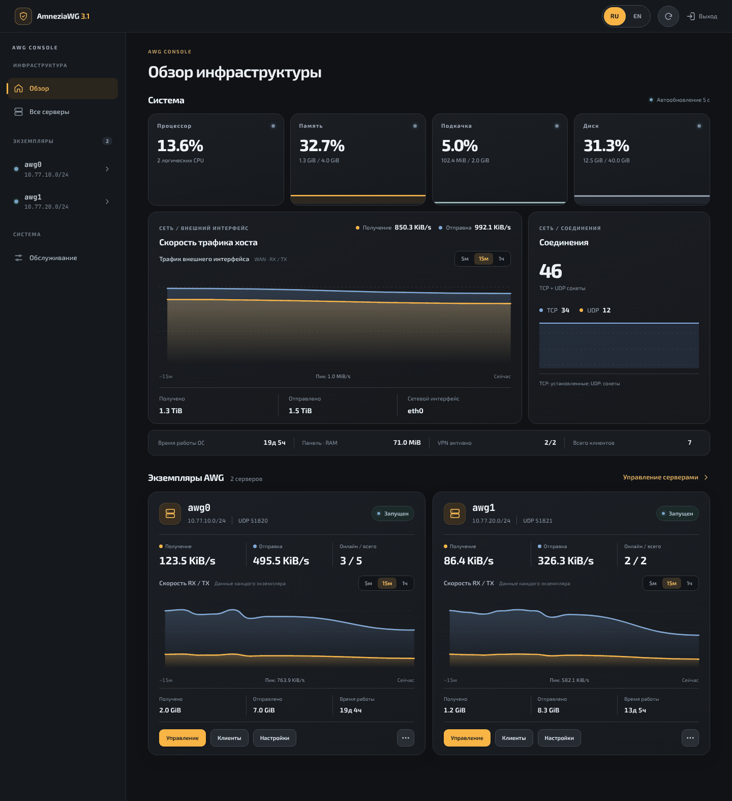
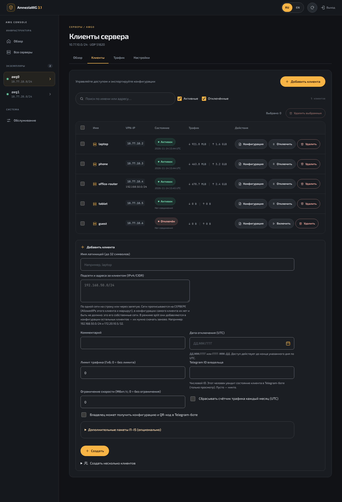
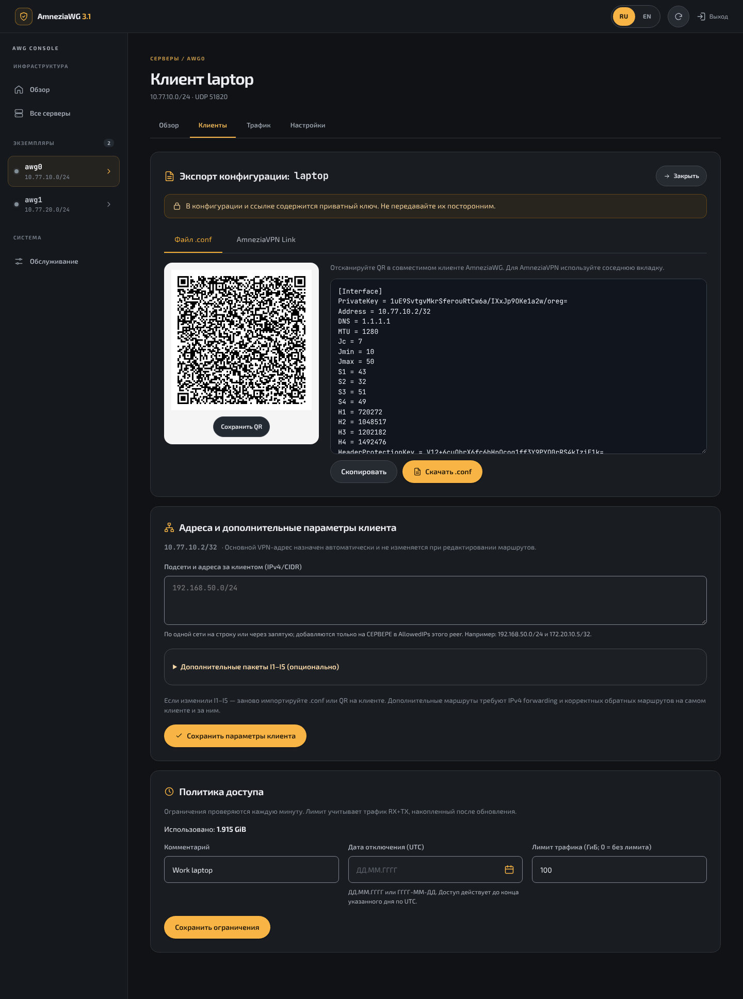
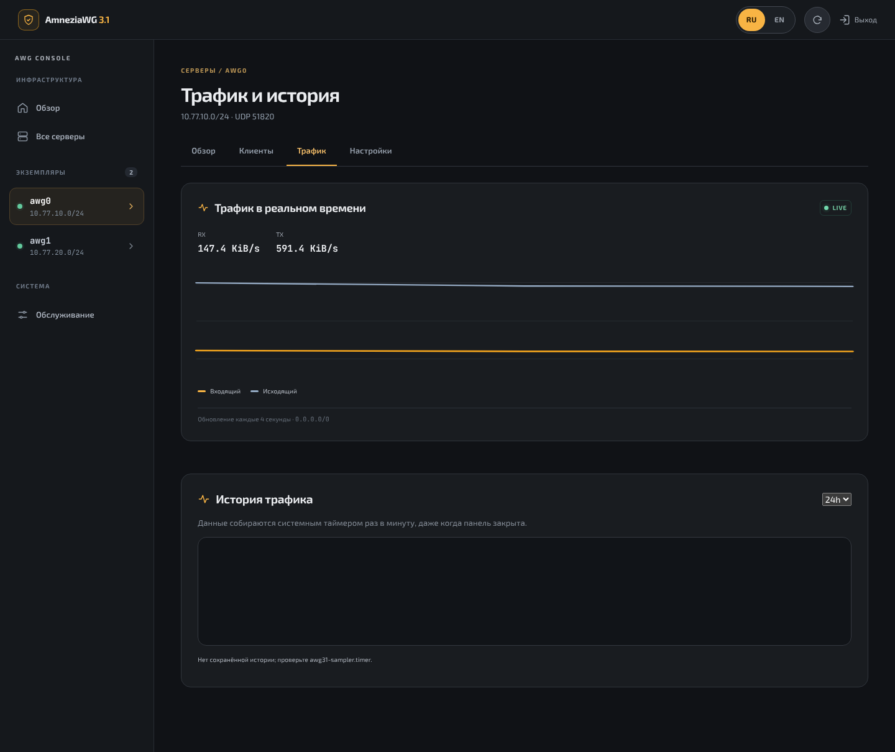
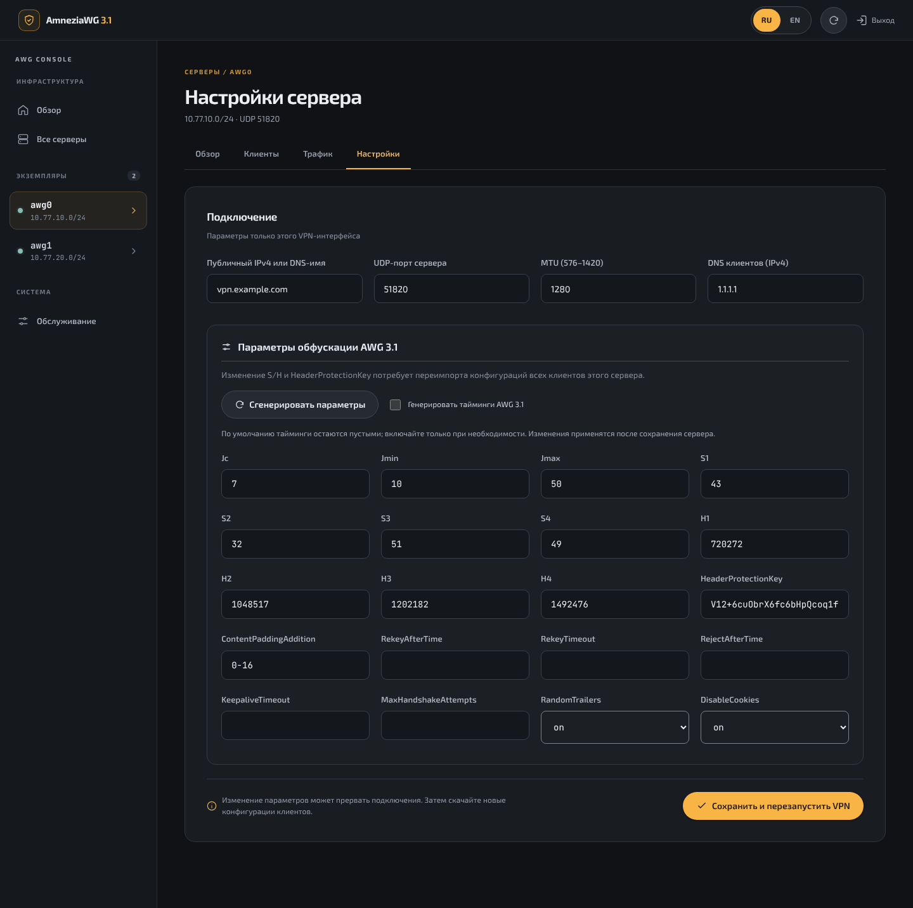
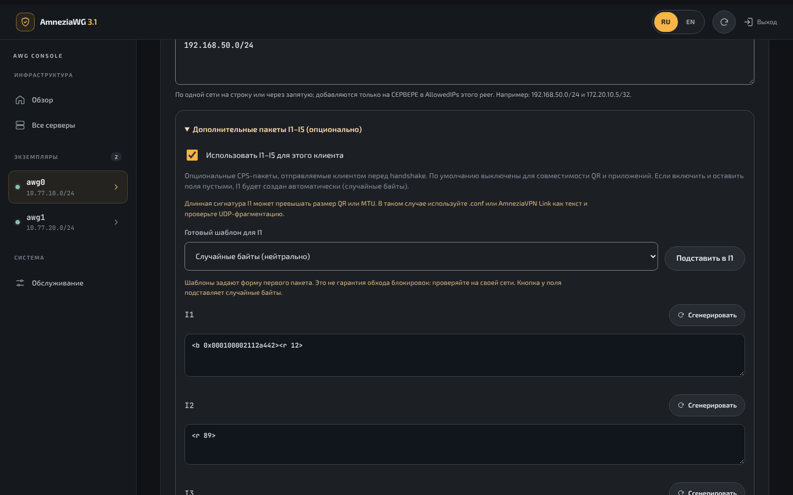
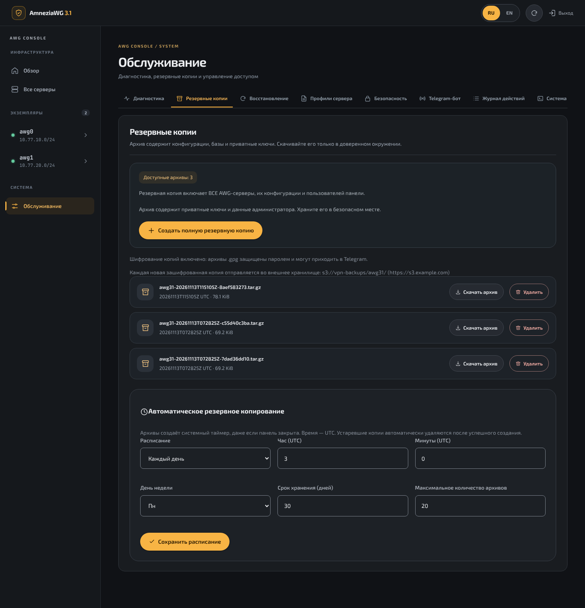

# AmneziaWG 3.1 Console

[English](README.md) · **Русский**

Установщик и веб-консоль для **AmneziaWG 3.1** на собственном сервере: модуль ядра через DKMS, интерактивный мастер установки и двуязычная (RU/EN) панель для серверов, клиентов, трафика и резервных копий. Без Docker, без облачного управления, без загрузок с CDN.

Версия **0.10.0** · лицензия MIT · проект не связан с разработчиками AmneziaVPN.



## Возможности

- **Только AmneziaWG 3.1.** Мастер собирает официальный модуль ядра (зафиксированный коммит) и утилиты (зафиксированный тег) и не продолжает работу с другой версией.
- **Случайная обфускация у каждого сервера.** `S1–S4`, `H1–H4`, `Jc`, `HeaderProtectionKey` генерируются для каждого сервера, включая первый, и перегенерируются в панели.
- **Несколько независимых серверов** (`awg0`, `awg1`, … до 8), у каждого свои ключи, подсеть, UDP-порт и клиенты.
- **Клиенты:** скачивание `.conf`, QR-код, ссылка `vpn://` для AmneziaVPN, комментарий, срок действия, лимит трафика (пожизненный или со сбросом каждый месяц), ограничение скорости, сети за клиентом (site-to-site), создание до 50 нумерованных клиентов разом с ZIP-архивом конфигураций, массовое удаление.
- **Переключатели трафика у каждого сервера:** клиенты видят друг друга или изолированы (в том числе от клиентов других серверов); доступ к частным сетям за сервером можно закрыть; службы самого сервера (SSH, панель) можно закрыть от клиентов; IPv6 клиентов можно направить в туннель и отбросить. Адреса сервиса метаданных облака закрыты для клиентов всегда. Сети за клиентом работают в любом положении.
- **Пометка устаревшей конфигурации:** в списке клиентов видно, кому нужен новый файл после изменения настроек.
- **Пакеты I1–I5:** кнопка «Сгенерировать» у каждого поля и готовые шаблоны для `I1` (случайные байты, DNS-запрос, STUN, пакет в форме QUIC). Если включить их с пустыми полями, `I1` создаётся автоматически.
- **Мониторинг:** процессор, память, подкачка, диск и трафик внешнего интерфейса, графики по каждому серверу, история за 30 дней, которую собирает systemd-таймер.
- **Резервные копии:** полные архивы с контрольными суммами, скачивание, расписание (ежедневно или еженедельно), срок хранения, восстановление с защитным снимком; по желанию — шифрование паролем (OpenPGP), после чего бот присылает каждую новую копию в Telegram.
- **Двухфакторный вход:** коды TOTP из любого приложения-аутентификатора в дополнение к паролю.
- **Безопасная схема:** панель работает от непривилегированного пользователя на `127.0.0.1`; действия от root идут через один узкий список `sudo`, который обслуживает локальный помощник от root, поэтому страницы открываются быстро и при сотнях клиентов; строгий CSP, CSRF-токены, хеш пароля scrypt, журнал действий.
- **Telegram-бот (по желанию):** клиенты, конфигурации с QR-кодами, запуск и остановка серверов, резервные копии и уведомления — через собственный, более узкий список `sudo`.
- **Nginx по желанию:** обратный прокси с самоподписанным или вашим сертификатом.

## Требования

| | |
|---|---|
| ОС | Ubuntu 24.04 / 26.04 LTS, Rocky Linux 9 / 10 |
| Процессор | x86_64 или aarch64 |
| Доступ | root, интерактивный терминал, исходящий доступ к GitHub и PyPI |
| Сеть | публичный IPv4-адрес (или DNS-имя) и свободный UDP-порт |

Установщику нужны заголовки ядра, совпадающие с работающим ядром. Secure Boot можно не отключать: мастер попросит зарегистрировать ключ DKMS (MOK) из консоли сервера после перезагрузки.

## Быстрый старт

Запускайте от root (если вы не root, сначала `sudo -i`):

```bash
bash <(curl -Ls https://raw.githubusercontent.com/stepm65/amneziawg31-installer/main/install.sh)
```

Чтобы установить конкретную версию, добавьте её тег (например, `v0.9.6`):

```bash
bash <(curl -Ls https://raw.githubusercontent.com/stepm65/amneziawg31-installer/main/install.sh) v0.9.6
```

Чтобы установить текущую сборку из ветки `main` (это не релиз), укажите `dev-latest`:

```bash
bash <(curl -Ls https://raw.githubusercontent.com/stepm65/amneziawg31-installer/main/install.sh) dev-latest
```

Без root-оболочки тот же установщик запускается так: `curl -Ls https://raw.githubusercontent.com/stepm65/amneziawg31-installer/main/install.sh | sudo bash` (для версии добавьте `-s -- v0.9.6`).

Установщик собирает модуль ядра и утилиты, затем запускает короткий мастер. У каждого вопроса есть значение по умолчанию, достаточно нажимать Enter:

1. Подсеть VPN (`/24`…`/29`, по умолчанию `10.77.10.0/24`), UDP-порт, MTU.
2. Публичный IPv4 или DNS-имя сервера, DNS для клиентов.
3. Режим трафика: **full** (весь IPv4 клиента через VPN, NAT на сервере) или **split** (только подсеть VPN).
4. Локальный TCP-порт панели и имя первого клиента.
5. Обратный прокси: без него, Nginx с самоподписанным сертификатом или Nginx с вашим сертификатом.
6. Пароль администратора: введите свой (дважды, не короче 12 символов) или нажмите Enter, и случайный пароль будет создан и показан один раз в конце.

Сгенерированный пароль записывается в `/root/awg31-initial-password.txt` (доступен только root) и на экран не выводится. Если активен ufw или firewalld, мастер предложит открыть в нём порт VPN.

После установки выполните `sudo awg31`, чтобы увидеть команды управления: состояние, обновление, резервные копии, сброс пароля, порт панели, настройка Nginx, удаление и другие.

Каждый релиз публикуется вместе с файлом `.sha256`. И `install.sh`, и `awg31 update` сверяют архив с этой суммой и прерываются при несовпадении, до распаковки. Сумма защищает от повреждённой или оборванной загрузки; она берётся с той же страницы релиза, что и архив. `dev-latest` не является релизом и по сумме не проверяется.

Перед установкой на сервер, который уже чем-то занят, сделайте snapshot VPS и сохраните доступ к консоли. После установки откройте UDP-порт в файрволе провайдера.

Если Nginx не ставили, заходите в панель через SSH-туннель:

```bash
ssh -L 8080:127.0.0.1:8080 root@ваш-сервер
# затем откройте http://localhost:8080
```

Если страница входа открывается снова и снова, браузер не принимает защищённую cookie по обычному HTTP: используйте для туннеля Chrome или Firefox либо настройте Nginx (`sudo awg31 nginx`).

Хотите сначала прочитать код? Клонируйте репозиторий и выполните в нём `sudo bash install.sh`: результат тот же.

### Установка без вопросов

Для автоматизации задайте `AWG31_UNATTENDED=1`: вопросы не задаются, используются значения по умолчанию, если переменная их не переопределяет.

```bash
curl -Ls https://raw.githubusercontent.com/stepm65/amneziawg31-installer/main/install.sh | \
  sudo env AWG31_UNATTENDED=1 AWG31_ENDPOINT=vpn.example.com AWG31_PORT=51820 bash
```

| Переменная | По умолчанию |
|---|---|
| `AWG31_SUBNET` | `10.77.10.0/24` |
| `AWG31_PORT` | `51820` |
| `AWG31_MTU` | `1280` |
| `AWG31_ENDPOINT` | определённый публичный IPv4 |
| `AWG31_DNS` | `1.1.1.1` |
| `AWG31_MODE` | `full` |
| `AWG31_UPLINK` | интерфейс маршрута по умолчанию |
| `AWG31_PANEL_PORT` | `8080` |
| `AWG31_FIRST_CLIENT` | `test-client` (`skip` — не создавать) |
| `AWG31_PASSWORD_FILE` | нет: пароль генерируется в `/root/awg31-initial-password.txt` |
| `AWG31_OPEN_FIREWALL` | `yes`: открыть UDP-порт в активном ufw/firewalld |
| `AWG31_NGINX_CHOICE` | `0` (без Nginx); для `1`/`2` нужен ещё `AWG31_NGINX_HOST`, для `2` — `AWG31_NGINX_CERT`, `AWG31_NGINX_KEY` |
| `AWG31_TELEGRAM_TOKEN`, `AWG31_TELEGRAM_ADMINS` | не заданы: без бота (см. [Telegram-бот](#telegram-бот)) |

## Панель

| Клиенты | Экспорт |
|---|---|
|  |  |

| Трафик | Настройки сервера |
|---|---|
|  |  |

| Редактор I1–I5 | Резервные копии |
|---|---|
|  |  |

На скриншотах демонстрационные данные.

### Шаблоны I1–I5

| Шаблон | Что отправляется перед handshake |
|---|---|
| Случайные байты | один пакет из 40–119 случайных байт |
| DNS-запрос | корректный запрос A-записи популярного домена со случайным ID |
| STUN Binding Request | запрос из 20 байт по RFC 5389 со случайным идентификатором |
| QUIC Initial с ClientHello | полный пакет QUIC v1 Initial на 1200 байт с TLS 1.3 ClientHello и выбранным именем сервера (SNI); расшифровывается как настоящий QUIC, в тестах его принимает реальная серверная реализация QUIC |
| QUIC Initial, только форма | тот же заголовок и размер, случайное содержимое и случайный идентификатор при каждой отправке; короткая запись, помещается в QR, но как QUIC не расшифровывается |

Короткая запись не значит маленький пакет: `<r 1000>` — это 1000 случайных байт в сети. Шаблон с ClientHello записывается hex-строкой из 2400 символов, одинаков при каждом подключении и не помещается в QR-код, поэтому передавайте клиенту файл `.conf`. Можно вставить и собственный записанный пакет в виде `<b 0x…>`.

Шаблоны задают только форму первых пакетов. Помогут ли они против конкретного фильтра, зависит от сети, поэтому проверяйте там, где пользуетесь VPN. После изменения I1–I5 заново импортируйте конфигурацию на клиенте.

## Консоль сервера

```text
sudo awg31 status           панель и экземпляры VPN
sudo awg31 update [VER]     обновить до последнего релиза, vX.Y.Z или dev-latest
sudo awg31 version          установленная версия
sudo awg31 servers          настроенные интерфейсы
sudo awg31 doctor           проверка ядра, DKMS и интерфейса
sudo awg31 backup           создать полную резервную копию
sudo awg31 backups          список резервных копий
sudo awg31 restore-check N  проверить архив
sudo awg31 restore N        восстановить архив (VPN перезапустится)
sudo awg31 reset-password   задать новый пароль панели
sudo awg31 totp-off         отключить двухфакторный вход (потерян аутентификатор)
sudo awg31 backup-encryption on|off|status   шифровать копии паролем
sudo awg31 port N           сменить локальный TCP-порт панели
sudo awg31 uninstall        удалить консоль; с --purge удаляются и данные VPN
sudo awg31 nginx            настроить HTTPS-прокси Nginx
sudo awg31 telegram         подключить Telegram-бота (status | test | off)
sudo awg31 restart-panel    перезапустить только веб-панель
sudo awg31 logs             журнал панели
```

## Telegram-бот

По желанию. Бот управляет клиентами и серверами из Telegram и сообщает о событиях. Он сам опрашивает Telegram, поэтому входящий порт не открывается.

```bash
sudo awg31 telegram          # подключить: спросит токен от @BotFather и определит ваш Telegram ID
sudo awg31 telegram status   # работает ли бот и кому он отвечает
sudo awg31 telegram test     # отправить тестовое сообщение
sudo awg31 telegram off      # остановить бота и удалить токен с сервера
```

| Бот умеет | Только в панели или консоли |
|---|---|
| создать клиента и прислать его `.conf` и QR-код | удалить сервер, создать сервер |
| включить, отключить, удалить клиента; задать срок и лимит | менять настройки сервера, обфускацию, сети клиента |
| показать серверы, клиентов, трафик, состояние модуля ядра и панели | восстановить, скачать или удалить резервную копию |
| запустить, остановить, перезапустить сервер | сменить пароль панели |
| создать резервную копию | |

Уведомления (каждую группу можно отключить при настройке): сервер остановился или снова работает, модуль ядра не загружен, служба панели остановилась; клиент отключён по сроку или лимиту, срок клиента истекает в ближайшие три дня; вход в панель, неудачные попытки входа, смена пароля; создана резервная копия или копия по расписанию не создалась.

Администраторы — только перечисленные числовые Telegram ID и только в личном чате; кроме владельцев клиентов (ниже), остальным бот не отвечает совсем. Удаление клиента и остановка сервера требуют подтверждения. Всё, что сделано через бота, попадает в журнал действий вместе с Telegram ID.

### Роли, сводка и настройки в панели

Раздел **«Обслуживание → Telegram-бот»** в панели показывает, работает ли бот, и позволяет менять, кому он отвечает и о чём сообщает; токен там не показывается. Кроме администраторов есть **наблюдатели**: они видят те же экраны и получают уведомления, но у них нет кнопок действий и изменить они ничего не могут. **Сводку** можно получать каждый день или по понедельникам после 09:00 по времени сервера: серверы, клиенты на связи, трафик с прошлой сводки, самые активные клиенты, у кого срок истекает в течение недели и кто не подключался месяц.

Когда включено шифрование копий (`sudo awg31 backup-encryption on`), каждая новая копия приходит администраторам файлом `.gpg`. Незашифрованные архивы не отправляются никогда.

### Владельцы клиентов

Клиенту можно указать числовой Telegram ID человека, который им пользуется: поле **Telegram ID владельца** в форме нового клиента и на странице клиента или кнопка **Telegram ID** в боте. Этот человек пишет тому же боту и видит один экран только для просмотра со своими клиентами: включён или отключён (и почему), израсходованный трафик и лимит, последнее соединение, срок действия. За три дня до окончания срока он получает сообщение. Один ID можно указать нескольким клиентам, в том числе на разных серверах.

Владелец не может что-либо изменить, увидеть других клиентов, серверы и адреса. По умолчанию он не может и скачать конфигурацию. Переключатель **«Владелец может получить конфигурацию и QR-код в Telegram-боте»** (рядом с полем ID; в боте — кнопка под клиентом) разрешает это для одного клиента: у владельца появляются кнопки **«Конфиг»** и **«QR»**, пока клиент включён. Каждая выдача записывается в журнал действий, и о ней сообщается администраторам (группа `security`). Переключатель сам выключается, когда ID владельца меняют или убирают.

У владельца клиента со сроком действия есть кнопка **«Продлить»**: администраторы получают запрос с готовыми ответами (+7, +30, +90 дней, отказать), а владельцу сообщается результат. Один запрос по клиенту в сутки. Владельцу также сообщается, когда израсходовано 80 % лимита, когда клиент отключён по сроку или лимиту и когда месячный лимит начался заново. Свой числовой ID человек узнаёт у любого «user info»-бота в Telegram, а вашему боту должен один раз нажать **Start**: Telegram не позволяет боту писать первым.

Без вопросов: `AWG31_TELEGRAM_TOKEN` и `AWG31_TELEGRAM_ADMINS` (ID через запятую), по желанию `AWG31_TELEGRAM_LANG` (`ru`/`en`) и `AWG31_TELEGRAM_NOTIFY` (`all`, `none` или список из `server,clients,security,backups`). Работают и с установщиком, и с `sudo -E awg31 telegram`.

## Обновление

```bash
sudo awg31 update            # последний релиз
sudo awg31 update v0.9.6     # конкретный релиз
sudo awg31 update dev-latest # текущая сборка из main
```

Повторный запуск команды из «Быстрого старта» на сервере, где консоль уже стоит, делает то же самое. `awg31 update` запускает установщик из уже установленного релиза и не ставит более старую версию без `--allow-downgrade`. Обновление заменяет панель, контроллер, шрифты и список `sudo`, а также обновляет Python-пакеты в пределах поддерживаемых версий. Интерфейсы, ключи, клиенты и правила файрвола остаются как есть. Копия заменённых файлов и баз сохраняется в `/var/backups/awg31-upgrade.*`.

Если в установленном `awg31` ещё нет команды `update`, один раз выполните `bash <(curl -Ls https://raw.githubusercontent.com/stepm65/amneziawg31-installer/main/install.sh) --upgrade`.

Если у сервера появилось предупреждение, что `H1–H4` равны `1, 2, 3, 4`, нажмите **«Сгенерировать параметры»** в его настройках, сохраните и заново раздайте конфигурации клиентам.

### Прерванная установка

Если установщик остановился после создания VPN, но до запуска панели, существующий сервер он не перезапишет. Если ничего ещё не создано (сбой случился до шага с VPN), просто запустите установщик снова. Если VPN уже создан и остановка случилась после шага с паролем администратора, завершите настройку из клона репозитория. Чтобы выбросить недоделанную установку и начать заново, запустите установщик с `--uninstall --purge`.

```bash
git clone https://github.com/stepm65/amneziawg31-installer.git
sudo bash amneziawg31-installer/scripts/resume-panel.sh
```

## Где что лежит

| Путь | Содержимое |
|---|---|
| `/etc/amnezia/amneziawg/awgN.conf` | конфигурации серверов (приватные ключи) |
| `/var/lib/awg31-panel/` | базы клиентов, метрики хоста |
| `/etc/awg31-panel/auth.json` | хеш пароля и ключ сессий |
| `/var/backups/awg31-panel/` | резервные копии и снимки перед изменениями |
| `/var/log/awg31-panel/audit.jsonl` | журнал действий |
| `/etc/awg31-bot/telegram.json` | токен Telegram-бота и ID администраторов |
| `/run/awg31/control.sock` | сокет помощника контроллера (`awg31-helper.service`) |
| `/opt/awg31-panel/` | код панели, окружение Python, шрифты |

## Безопасность

- Клиентский `.conf`, ссылка `vpn://` и QR-код содержат приватный ключ. У кого они есть, тот может подключиться.
- Резервные копии содержат все приватные ключи и учётные данные панели и **по умолчанию не шифруются**. Включите шифрование командой `sudo awg31 backup-encryption on` и храните пароль отдельно от сервера: без него зашифрованную копию не восстановить на другом сервере (`gpg -d файл.tar.gz.gpg` открывает её на любой машине). Сам пароль хранится на сервере и доступен только root, поэтому шифрование защищает архивы, покинувшие сервер, а не взломанный сервер.
- Не публикуйте панель без HTTPS. Создаваемый сайт Nginx отправляет HSTS, ограничивает число попыток входа с одного адреса и может пускать только с указанных вами адресов (`sudo awg31 nginx`).
- Выход из панели завершает все её сессии, включая скопированную cookie.
- Восстановление из резервной копии сохраняет текущий пароль администратора; пароль из архива берётся, только если своего нет.
- В режиме full через туннель идёт только IPv4. Включите «IPv6 у клиентов: блокировать» в настройках сервера (клиентам понадобится новая конфигурация) или отключите IPv6 на клиентах, иначе IPv6-трафик пойдёт мимо VPN.
- По умолчанию клиенты VPN достают до служб самого сервера по его VPN-адресу (например, до SSH). Настройка сервера «Доступ клиентов к службам самого сервера → Запрещён» закрывает их: проходят только ответы, ping и DNS (если сервер — DNS клиентов). Остальными правилами INPUT консоль не управляет.
- Telegram-бот присылает конфигурации клиентов (приватные ключи) в ваш чат с ним; они остаются в облаке Telegram. Тот, кто владеет Telegram-аккаунтом администратора, может создавать и удалять клиентов и останавливать серверы, поэтому включите в этом аккаунте двухэтапную аутентификацию. Токен бота удаляется командой `sudo awg31 telegram off` и при удалении консоли.
- Двухфакторный вход настраивается в разделе **«Обслуживание → Безопасность»**. Потерянный аутентификатор сбрасывается из консоли: `sudo awg31 totp-off`.
- Ограничение скорости действует в обе стороны и обеспечивается `tc` на VPN-интерфейсе. Месячный лимит сбрасывается первого числа по UTC.
- После обновления ядра запустите `sudo awg31 doctor`: DKMS пересоберёт модуль, только если установлены заголовки нового ядра.

Подробнее в [SECURITY.md](SECURITY.md).

## Совместимость

| Платформа | Состояние |
|---|---|
| Ubuntu 26.04 | сборка и загрузка модуля, `awg0` и панель подтверждены на рабочем сервере |
| Ubuntu 24.04 | поддерживается установщиком, на рабочем сервере пока не подтверждено |
| Rocky Linux 9 / 10 | поддерживается установщиком, на рабочем сервере пока не подтверждено; при firewalld проверьте NAT в режиме full самостоятельно |

Каждый коммит также по-настоящему устанавливается на машине GitHub Actions с Ubuntu 24.04: установка без вопросов, модуль ядра, правила файрвола, панель, обновление на месте, смена порта и полное удаление.

На рабочем сервере пока не подтверждены: восстановление из резервной копии, одновременная работа нескольких серверов, блокировка IPv6 со всеми клиентскими приложениями, ссылки `vpn://` и QR-коды со всеми выпусками AmneziaVPN (эталонный формат — обычный `.conf`).

## Разработка

```bash
python -m pip install -r src/requirements.txt pytest httpx cryptography
python -m pytest -q
```

Релизы собирает GitHub Actions: укажите номер в `VERSION`, затем отправьте тег `vX.Y.Z` или опубликуйте релиз с этим тегом на github.com, и workflow прогонит тесты, соберёт `awg31-console-vX.Y.Z.tar.gz` с файлом `.sha256` и опубликует релиз.

Сторонние компоненты и лицензии шрифтов перечислены в [THIRD_PARTY.md](THIRD_PARTY.md).
